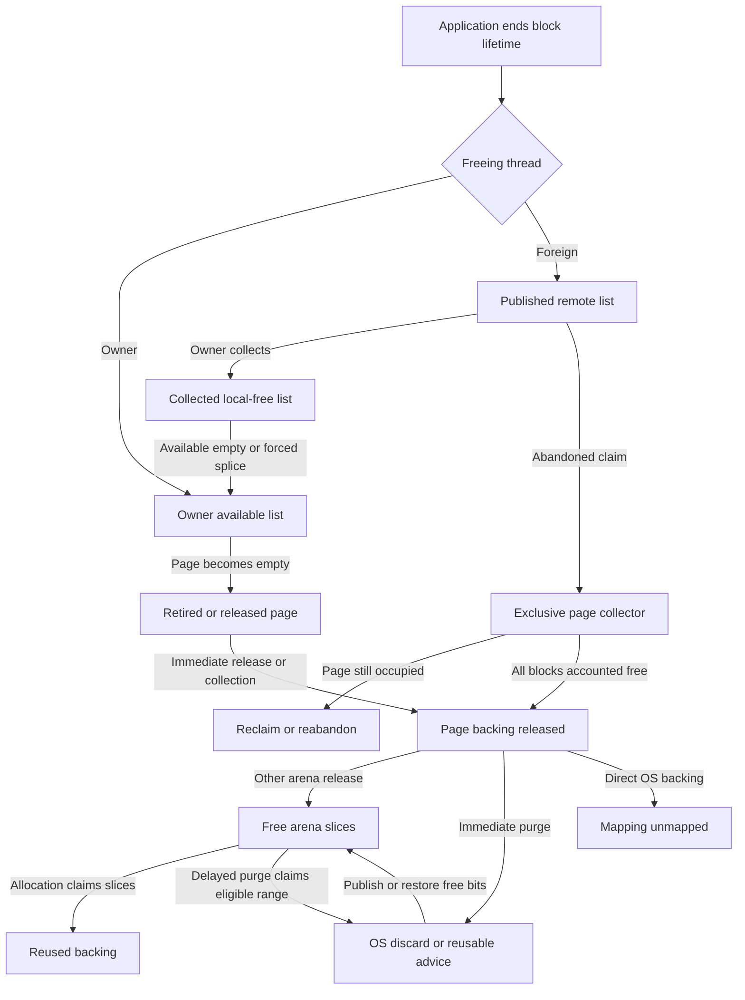

# mechanical_mimalloc — Gate A investigation

**Architecture, ownership traces, retention model, and proposed measurements**  
**Date:** 2026-10-21  
**Repository:** https://github.com/whb07/mechanical_mimalloc  
**Pinned HEAD:** `08cf8a0d1dc04245cf7e5e5bf784a8fd52e53d46` (`08cf8a0`, master)  
**Commit subject:** “Note collect_after_remote_free placement changes in the screen”

## Scope and evidence conventions

This is **Phase A only**, following the supplied investigation instructions. The GitHub connector supplied the repository. The local snapshot contains all 584 tracked blobs; their Git hashes, the tree, and the original commit were verified. The investigation made no tracked-file changes, commits, production prototypes, builds, benchmark runs, or test executions. This report is the requested ignored investigation artifact. Historical worklog results are evidence of earlier decisions, not fresh results at this HEAD.

The available execution workspace is Linux x86_64, not the specified Apple M5 Pro. No M5 measurements or remote-host work occurred. This Linux workspace has not been qualified as an isolated authoritative performance host. Host selection and measurement execution remain Phase B work.

- `[V: file:line@08cf8a0]` means inspected source or documentation at the repository pin. A citation to a report verifies what that report records; it does not independently verify its historical timings.
- `[H]` means a reasoned hypothesis or proposed experiment/design choice, with no measured benefit implied.
- `[Q]` means an unresolved question or explicit coverage limit.
- No `[M: ...]` performance claims occur: no new experiments were run, and historical ignored `target/` artifacts were not supplied by the tracked repository snapshot.
- **T** = Rust/C 3.3.2 difference, including accepted intentional differences. **D** = behavior or limitation shared with the bundled C design. **U** = a later upstream change or an upstream bug. A U finding does not establish that its fix applies to this Rust port.
- External primary references have their own repository pins or named document links; they are never attributed to `08cf8a0`. Source citations in the trace appendix are repository-relative. A citation resolves to `https://github.com/whb07/mechanical_mimalloc/blob/08cf8a0d1dc04245cf7e5e5bf784a8fd52e53d46/<file>#L<line>`.

The architecture assessment is intentionally brief; detailed evidence, traces, and limits follow it. The experiment shortlist and rejection notes are **Gate A proposals**, not completed Phase B results or Phase C approvals.

## 1. Architectural assessment

**[H] Keep the current ownership architecture as the starting point.** It separates owner-local allocation from atomic foreign frees, provides a collector-ownership protocol for abandoned pages, and controls arena reuse separately from OS purging. Immediate purge occurs before free-bitmap publication; delayed purge later claims already-free slices. The primary unresolved policy issue is when each mechanism runs and how much touched memory waits at each boundary. A new remote-free queue, page index, or cache is not yet justified. [V: src/types/page_states.rs:296@08cf8a0] [V: src/types/atomic/thread_free.rs:145@08cf8a0] [V: src/allocator/arena/abandoned.rs:19@08cf8a0] [V: src/allocator/arena/purge.rs:33@08cf8a0] [V: src/allocator/arena/purge.rs:126@08cf8a0]

**(D) Freeing a block, releasing a page, making slices reusable, and relinquishing physical backing are different transitions.** A sole empty normal page can remain on an owner queue for 16 or 4 retirement-collection cycles. After page release, a positive purge delay records a deadline; no timer or worker independently executes the drain. A collector on another thread can reach shared arena purging but cannot collect the local lists of a different live owner. [V: src/allocator/page.rs:425@08cf8a0] [V: src/allocator/policy/compat.rs:131@08cf8a0] [V: src/allocator/arena/purge.rs:40@08cf8a0] [V: src/allocator/arena/purge.rs:425@08cf8a0] [V: src/allocator/thread_heap.rs:1068@08cf8a0]

**(T) Accepted throughput policies change the progress conditions.** X26 pushes owner frees directly onto `free`, allowing a small hot loop to avoid generic maintenance indefinitely. X31 retains full pages until a non-main allocator TLD has been initialized, then depends on owner maintenance to abandon previously retained pages. A foreign thread that only frees need not initialize that TLD. X29 permanently arms THP after 32 MiB of outstanding arena-page bytes, so a small post-burst heap differs from one that has always stayed small. Their post-burst residency costs remain unmeasured. [V: src/types/page_states.rs:406@08cf8a0] [V: src/allocator/page.rs:2319@08cf8a0] [V: src/allocator/init/thread.rs:430@08cf8a0] [V: src/allocator/page.rs:173@08cf8a0] [V: src/allocator/arena/thp.rs:17@08cf8a0] [H]

**(T) Reproduce two concrete static parity findings separately.** The Unix hinted-mapping helper discards a successful but insufficiently aligned first mapping before retrying, while C returns it for outer alignment handling. Also, secure release decommit omits protection when debug is off, whereas C retains it at secure level 4. These are code-verified differences; neither has a runtime reproduction or measured RSS impact here. [V: src/platform/unix.rs:548@08cf8a0] [V: mimalloc-3.3.2/src/prim/unix/prim.c:313@08cf8a0] [V: src/platform/unix.rs:783@08cf8a0] [V: mimalloc-3.3.2/src/prim/unix/prim.c:503@08cf8a0]

**[H] First measure the release event, then tune policy.** Proposed X33 compares an idle owner, hot-loop owner, generic-active owner, explicit owner collection, separate-thread collection, and owner exit using the same touched allocation/free history. This determines whether a purge option can reach the bytes in question. Use direct OS memory sampling: the Unix `ProcessInfo.current_rss` path retains its committed-byte estimate. [V: src/allocator/stats/process.rs:93@08cf8a0] [V: src/platform/unix.rs:1088@08cf8a0]

## 2. Verified findings, hypotheses, and open questions

### F1 — D: retirement and purge are separate progress gates

The all-free sole normal page is retained by `retire_expire`; nonsole empty pages can be released immediately. Retired-bin scans decrement the countdown or release immediately when forced. Only page release reaches arena free/purge scheduling. Bundled C has the same two-stage design. [V: src/allocator/page.rs:395@08cf8a0] [V: src/allocator/page.rs:493@08cf8a0] [V: src/allocator/arena/purge.rs:12@08cf8a0] [V: mimalloc-3.3.2/src/page.c:432@08cf8a0] [V: mimalloc-3.3.2/src/arena.c:2059@08cf8a0]

[H] Lower `purge_delay` can help only memory that has reached the arena release path. It cannot by itself collect remote lists, release an owner-retired page, or eliminate a live survivor. [Q] Which boundary dominates realistic burst-idle workloads at this HEAD?

### F2 — T: X26 changes maintenance progress, as documented and implemented

Owner frees now update `free`, clear `free_is_zero`, and decrement `used`; bundled C owner frees replenish `local_free`. The generic counter advances only on generic allocation. The periodic maintenance body runs deferred callbacks, retired-page processing, and X31's kept-full-page flush at 1,000 generic calls. The worklog expressly accepts postponement under LIFO churn. [V: src/types/page_states.rs:406@08cf8a0] [V: src/types/page_states.rs:553@08cf8a0] [V: mimalloc-3.3.2/src/free.c:40@08cf8a0] [V: src/allocator/policy/compat.rs:38@08cf8a0] [V: src/allocator/page.rs:2319@08cf8a0] [V: PERFORMANCE_WORKLOG.md:1632@08cf8a0]

[H] An active small-loop owner may postpone unrelated cold-page and arena work. This is distinct from the completely idle D case. Lowering `generic_collect` does not create progress when generic allocation is never entered. X23 already rejected a per-free heartbeat; measuring X26's residency tradeoff does not justify reinstating that rejected implementation. [V: PERFORMANCE_WORKLOG.md:1525@08cf8a0] [Q] Is there a material RSS cost, and which event would address it within the throughput budget?

### F3 — T: X31's “multithreaded” state means allocator initialization

The flag is set in non-main TLD creation, not by the existence of another OS thread or by ordinary remote publication. A free-only consumer can leave it false. Even after a consumer initializes the allocator, the owner's existing full queue is traversed by `mi_theap_abandon_kept_full_pages` only when that owner executes a calling path. C's full-page transition has no corresponding process-wide condition. [V: src/allocator/init/thread.rs:430@08cf8a0] [V: src/allocator/free.rs:620@08cf8a0] [V: src/allocator/page.rs:212@08cf8a0] [V: src/allocator/page.rs:2330@08cf8a0] [V: mimalloc-3.3.2/src/page.c:382@08cf8a0]

There is a focused X31 test: it resets the flag in an isolated process, initializes a secondary allocator user, directly invokes the flush helper, and checks abandonment. It does not establish natural maintenance latency or free-only-consumer idle decay. [V: src/safe/tests.rs:919@08cf8a0]

[H] Compare three fresh-process histories: consumer only frees; consumer initializes after the burst; consumer initializes before the burst. Do not claim a leak or a measured regression from this source-level distinction.

### F4 — D: option zero and abandoned indexing need exact interpretation

`page_reclaim_on_free=0` does not universally prohibit reclaim into a different thread heap. After the common initialized/associated-heap/reclaim-enabled checks, the limit starts at zero; if neither branch changes it, a destination queue with count zero passes `count <= max_reclaim`. C implements the same branch structure. Negative values also affect `allow_page_reclaim` at heap initialization. [V: src/allocator/free/abandoned.rs:199@08cf8a0] [V: src/allocator/free/abandoned.rs:225@08cf8a0] [V: src/allocator/free/abandoned.rs:255@08cf8a0] [V: src/allocator/policy/compat.rs:59@08cf8a0] [V: mimalloc-3.3.2/src/free.c:329@08cf8a0]

Formerly full abandoned pages are initially unindexed. Remapping a sufficiently freed page into allocation-visible arena abandoned bits requires an associated current-thread heap; a free-only uninitialized consumer can fail that lookup. All-free destruction is checked first, so this does not establish a permanently leaked final block. [V: src/allocator/arena/abandoned.rs:376@08cf8a0] [V: src/allocator/free/abandoned.rs:383@08cf8a0] [V: src/allocator/arena.rs:2415@08cf8a0] [H] Sparse survivors may make this indexing distinction consequential.

### F5 — T: X29 has persistent burst-history state

`THP_ARMED` is a one-way process state. Before arming, outstanding arena-page bytes are counted; crossing 32 MiB arms huge-page advice. After arming, page removal stops adjusting that count and does not disarm THP. The threshold is not requested-live bytes. [V: src/allocator/arena/thp.rs:17@08cf8a0] [V: src/allocator/arena/thp.rs:32@08cf8a0] [V: src/allocator/arena/thp.rs:59@08cf8a0]

[H] Measure a formerly large heap after shrink, with sparse survivors and reburst. This differs materially from X29's small-never-armed case. No de-arming mechanism is recommended before that evidence. [V: PERFORMANCE_WORKLOG.md:1886@08cf8a0]

### F6 — U: the C main-theap initialization bug complicates the oracle

X30 fixes a bug shared with bundled C 3.3.2: static initialization of the main theap can bypass option/cookie initialization. Consequently identical option environment strings do not prove identical effective main-theap state. The Rust/C difference is documented, and the source initializer is the relevant control. [V: UPSTREAM_DIFF.md:108@08cf8a0] [V: PERFORMANCE_WORKLOG.md:1948@08cf8a0]

[H] Keep the unmodified C baseline, and add explicitly initialized worker/private-heap matched-policy diagnostic controls. Record effective state. Do not silently repair C and label that artifact “bundled C 3.3.2.” [Q] Which effective main-theap options differ in the actual selected artifacts and workload history?

### F7 — T: secure-release decommit differs from bundled C

Rust tests `MI_DEBUG == 0` alone; C tests `!MI_DEBUG && MI_SECURE <= 2`. At Rust secure level 4, release therefore differs in protection, recommit requirements, and potentially committed accounting. Existing secure parity checks build debug Rust and do not cover this specific protection transition. [V: src/platform/unix.rs:783@08cf8a0] [V: mimalloc-3.3.2/src/prim/unix/prim.c:503@08cf8a0] [V: src/internal/mod.rs:101@08cf8a0] [V: scripts/check-secure-mode-parity.py:130@08cf8a0] [V: scripts/check-secure-mode-parity.py:219@08cf8a0]

[H] Reproduce with a valid internal mapped region and matched release/secure configurations, checking `needs_recommit` and OS protections in an isolated child. Do not use a stale application pointer dereference as evidence of a valid-API defect. [Q] The runtime consequence, platform differences, and whether a repair affects performance are unmeasured.

### F8 — T: native interposition has its own fast-path implementation

Linux x86_64 release interpose artifacts without secure/guarded/tracking features enable `mi_c_malloc_fast`. Assembly exports implement malloc/free/calloc and some C++ entries; misses tail-dispatch into the Rust generic implementation. Local free and remote CAS also occur in assembly. A portable-Rust-only change can therefore leave the relevant native path untouched. [V: build.rs:343@08cf8a0] [V: build.rs:394@08cf8a0] [V: src/raw/macros.rs:355@08cf8a0] [V: src/raw/macros.rs:449@08cf8a0] [V: src/raw/macros.rs:481@08cf8a0]

[H] Record entrypoint/linkage, code placement and artifact hashes for comparisons. Audit which diagnostic counters an assembly entry bypasses before interpreting zero counts. A default/all-features test is not a substitute for the native release artifact. The worklog already records sensitivity to assembly placement. [V: PERFORMANCE_WORKLOG.md:58@08cf8a0]

### F9 — D: allocator accounting is not an RSS measurement

The Unix process-info implementation initializes current RSS to committed bytes and does not replace it with current OS residency; bundled C starts with the same estimate. Release decommit can discard backing while leaving `needs_recommit=false`, so committed bits need not fall with Linux physical residency. [V: src/allocator/stats/process.rs:93@08cf8a0] [V: src/platform/unix.rs:1088@08cf8a0] [V: mimalloc-3.3.2/src/stats.c:555@08cf8a0] [V: src/platform/unix.rs:765@08cf8a0] [V: src/platform/os.rs:648@08cf8a0]

[H] Treat logical occupancy, allocator accounting, address reservation, and OS physical memory as separate measurements. Use external Linux and native macOS sampling as specified below.

### F10 — T: potential mapping retention on a successful misaligned hint fallback

Rust `unix_mmap_prim_aligned` returns its first hinted result only when it is both nonnull and aligned to `try_alignment`. If the OS instead returns a successful, insufficiently aligned mapping, this branch proceeds to a second `mmap` without releasing or preserving the first pointer. Bundled C logs insufficient alignment but returns every successful first mapping; its outer aligned allocator releases that returned mapping if it needs an overreserve retry. [V: src/platform/unix.rs:537@08cf8a0] [V: src/platform/unix.rs:548@08cf8a0] [V: src/platform/unix.rs:554@08cf8a0] [V: mimalloc-3.3.2/src/prim/unix/prim.c:304@08cf8a0] [V: mimalloc-3.3.2/src/prim/unix/prim.c:313@08cf8a0] [V: mimalloc-3.3.2/src/os.c:369@08cf8a0]

The caller chain only propagates the helper's final result: `_mi_prim_alloc` writes that pointer, `mi_os_prim_alloc` accounts one returned mapping, and alignment rejection/trim/MemId creation operate on that returned base. None of those inspected paths recovers the first pointer. Thus **conditional ownership loss is verified in control flow; a runtime allocator leak is not yet reproduced**. The first range would also be absent from that accounting if this branch occurs. [V: src/platform/unix.rs:709@08cf8a0] [V: src/platform/os.rs:1169@08cf8a0] [V: src/platform/os.rs:1173@08cf8a0] [V: src/platform/os.rs:1247@08cf8a0] [V: src/platform/os.rs:1353@08cf8a0]

Eligibility is not restricted to explicit extreme-alignment API requests: sufficiently large OS allocations can promote `try_alignment` to the configured large-page size even with `allow_large=false`. The Unix configured size is 2 MiB and the promotion threshold is eight such pages. Whether the OS actually returns an insufficiently aligned successful hint result is a separate question. [V: src/platform/os.rs:1130@08cf8a0] [V: src/platform/os.rs:1134@08cf8a0] [V: src/platform/os.rs:1380@08cf8a0] [V: src/platform/unix.rs:35@08cf8a0] [V: src/platform/unix.rs:491@08cf8a0]

[H] Before attributing unexplained mapping growth to retention policy, use an isolated syscall-boundary falsification probe that supplies a genuine successful misaligned first mapping, then controls second-call success/failure. Record an external ledger of every successful mmap range and munmap, compare the bundled C path, and check ownership balance after normal teardown. Preserve valid OS-page alignment and valid API use. A forced syscall-boundary test demonstrates ownership behavior in the exercised branch; a real syscall trace reaching it, for example through an occupied hint, establishes target reachability. The existing aligned-stats test exercises trimming and allocator counters but does not force this branch or track all mappings. [V: tests/os_aligned_stats.rs:42@08cf8a0]

[Q] No branch frequency, leaked-byte count, memory-safety effect, or RSS regression is claimed. The first ordinary anonymous mapping is not touched through this lost reference; virtual mapping retention and physical residency can therefore differ sharply. This correctness lead should remain separate from policy experiment X33, and any repair needs its own reproduction and approval.

## 3. Retention and cost model

### 3.1 Separate a byte partition from ownership and VM attributes

At a quiescent page checkpoint, initialized capacity is partitioned into accounted `used`, available `free`, and collected `local_free`. Remote-freed blocks remain included in `used` until an authorized collector accounts for them. Partial abandoned collection deliberately leaves a published head counted until later collection. Consequently, adding “remote free bytes” to `used × block_size` double-counts those blocks. Also keep `reserved - capacity` distinct: it is unextended block capacity, not another free list. [V: src/types/page_batch.rs:256@08cf8a0] [V: src/allocator/page/lifecycle.rs:216@08cf8a0] [V: src/allocator/page/lifecycle.rs:308@08cf8a0] [V: src/allocator/page.rs:779@08cf8a0]

[H] Use the following accounting model, only at coordinated checkpoints, with separately measured backing extent:

`initialized block capacity = logically allocated blocks + pending remote-freed blocks + available blocks + collected local-free blocks`

`live usable bytes = requested live bytes + caller-usable excess`

`gross live-block extent = live usable bytes + alignment-prefix / padding / guard overhead excluded by the usable-size API`

The usable-size path subtracts interior-pointer adjustment and padding/guard deductions, so those bytes must not be called caller-usable capacity. [V: src/allocator/free.rs:429@08cf8a0] [V: src/allocator/free.rs:1418@08cf8a0] [V: src/allocator/aligned.rs:307@08cf8a0]

“Owned,” “abandoned,” “retired,” “resident,” and “committed” are attributes of those regions, not five extra additive byte categories. A partly occupied abandoned page is counted once in the page-capacity partition and separately labeled abandoned. Count inline padding/guards in gross block extent where the block-size definition includes them; count exterior guards, separate metadata, page tails and arena alignment slack outside block capacity. Guarded virtual extent need not have resident backing. Count each byte once. [V: src/types/page_states.rs:296@08cf8a0] [V: src/allocator/free.rs:429@08cf8a0] [V: src/allocator/page/bins.rs:12@08cf8a0] [V: src/allocator/arena/metadata.rs:27@08cf8a0] [H]

| Category | Determining structures/policy | Event permitting reuse or release |
|---|---|---|
| Requested live bytes | Application allocation ledger; record exact requests and valid frees/reallocations | Application ends the allocation lifetime. Allocator class counters alone do not reconstruct requested live bytes. [V: src/allocator/alloc.rs:156@08cf8a0] [H] |
| Usable bytes and rounding | Bin rounding, actual block size, alignment offset, padding/guard mode | A compatible request reuses the block; changing class geometry is a separate, unmeasured design choice. [V: src/allocator/page/bins.rs:12@08cf8a0] [V: src/allocator/aligned.rs:250@08cf8a0] |
| Partial-page slack | `used/capacity/reserved`, queue selection and survivor placement | Same-class reuse, ownership transfer, or the final live block becoming free; no general relocation of live pointers. [V: src/internal/page_metadata.rs:93@08cf8a0] [V: src/allocator/page.rs:1579@08cf8a0] |
| Available/local free capacity | Owner-only `free` and `local_free`; X26 owner LIFO | Owner pops `free`; empty-available transfer or forced splice exposes collected local blocks. [V: src/types/page_states.rs:406@08cf8a0] [V: src/allocator/page/lifecycle.rs:224@08cf8a0] |
| Pending remote frees | Atomic `xthread_free` head/claim word; `used` still includes these blocks | Owner detach/collection, or a successful abandoned claimant; free publication itself is insufficient for live-owner reuse. [V: src/types/atomic/thread_free.rs:145@08cf8a0] [V: src/types/atomic/thread_free.rs:207@08cf8a0] |
| Abandoned pages | Ownership bit, heap/bin abandoned bitmaps or OS abandoned list; full/unindexed distinction | Claim, collect, attach/reabandon, or all-free destruction. [V: src/allocator/arena/abandoned.rs:328@08cf8a0] [V: src/allocator/arena.rs:1302@08cf8a0] |
| Empty retained pages | Sole normal-page retirement countdown, per-thread retired-bin bounds | Owner reuse; retirement scan expires count; forced collection or teardown. [V: src/allocator/page.rs:425@08cf8a0] [V: src/allocator/page.rs:493@08cf8a0] |
| Empty/free arena ranges | `slices_free`, dirty/committed/purge bitmaps, expiration, pinning, minimum purge group | Any eligible allocator can claim free slices; purge separately claims them before OS advice. [V: src/allocator/arena/purge.rs:126@08cf8a0] [V: src/allocator/arena/purge.rs:249@08cf8a0] |
| Arena/heap/page-map metadata | Arena prefix and bitmaps, per-heap bitmap tables, separated metadata, map submaps, TLS/TLD | Metadata teardown when its lifetime permits; ordinary page release does not unmap the whole arena. [V: src/allocator/arena/metadata.rs:10@08cf8a0] [V: src/allocator/arena/metadata.rs:138@08cf8a0] [V: src/allocator/page_map.rs:764@08cf8a0] |
| Reserved virtual space | Arena sizing, alignment, direct OS mappings | `munmap` or corresponding backing-owner teardown; physical purge can occur while reservation remains. [V: src/allocator/arena/os_memory.rs:164@08cf8a0] [V: src/platform/unix.rs:405@08cf8a0] |
| Committed versus resident/reusable | Commit bitmap/accounting versus kernel mapping and physical-page state | OS advice, actual reclaim, compression and later faults; use distinct counters and OS observations. [V: src/platform/os.rs:648@08cf8a0] [V: src/platform/unix.rs:765@08cf8a0] [H] |

The following event graph summarizes the traced paths. Each arrow requires execution or a lifetime event; elapsed time alone does not traverse owner-local edges. [V: src/allocator/free.rs:526@08cf8a0] [V: src/allocator/free.rs:620@08cf8a0] [V: src/allocator/page.rs:395@08cf8a0] [V: src/allocator/arena/purge.rs:425@08cf8a0]

### 3.2 Workload dimensions

[H] More allocating threads can create more independent owner/bin tails even at the same total live bytes. More logical heaps can add lazily created arena-page tables. A broader size distribution occupies more bins and increases the number of candidate sole-retained pages. Long-lived sparse survivors can pin much more backing than their requested size. The allocation/free topology changes both remote CAS concentration and which thread can collect. Owner exit enables abandonment progress that a live idle owner cannot provide. These hypotheses follow the traced ownership and geometry; no magnitude is assigned. [V: src/allocator/arena/metadata.rs:97@08cf8a0] [V: src/allocator/page.rs:425@08cf8a0] [V: src/allocator/init/thread.rs:602@08cf8a0]

On the examined 64-bit geometry, arena slices are 64 KiB, small/medium/large page extents are 64 KiB/512 KiB/4 MiB, and the default arena reservation is 1 GiB. These are allocator geometry and reservation, not OS base-page size or physical residency. The direct small-allocation bound is 1,024 bytes; it is not the same threshold as the small-page object category used by retirement policy. [V: src/allocator/arena.rs:72@08cf8a0] [V: src/types/constants.rs:76@08cf8a0] [V: src/types/constants.rs:87@08cf8a0] [V: src/allocator/options/storage.rs:25@08cf8a0] [V: src/allocator/policy/compat.rs:131@08cf8a0]

### 3.3 Platform measurement contract — D

**Linux.** [V: external reference L1] `/proc/<pid>/smaps_rollup` provides mapping-derived RSS and PSS. PSS apportions shared pages; report both for multiprocess applications. Record `AnonHugePages` as a THP indicator and `LazyFree` when evaluating lazy discard, together with actual kernel THP settings. Do not treat reservation or `VmSize` as physical memory. [H] Sample from another process with monotonic timestamps and the same cadence for all arms.

[V: external reference L2] For private anonymous mappings, `MADV_DONTNEED` discards contents/backing so subsequent accesses obtain zero-filled pages; the mapping remains. `MADV_FREE` makes pages reclaimable lazily, with later writes cancelling the pending discard. Huge-page advice may increase physical-memory amplification. The port's Unix decommit chooses `MADV_DONTNEED` outside macOS, while its reset path tries `MADV_FREE` and falls back on unsupported advice. [V: src/platform/unix.rs:765@08cf8a0] [V: src/platform/unix.rs:801@08cf8a0]

**Native macOS.** XNU exposes `resident_size`, `reusable`, `compressed`, and `phys_footprint` separately. Marking eligible pages reusable can credit reusable accounting and reduce footprint without debiting physical residence in that accounting branch. A flat `resident_size` therefore does not alone prove that reusable advice failed. Conversely, a footprint drop does not establish immediate physical eviction. [V: apple-oss-distributions/xnu/osfmk/kern/task.c:6039@f6217f8] [V: apple-oss-distributions/xnu/osfmk/kern/task.c:6135@f6217f8] [V: apple-oss-distributions/xnu/osfmk/arm64/sptm/pmap/pmap.c:7845@f6217f8]

Rust decommit requests `MADV_FREE_REUSABLE`, with `MADV_DONTNEED` fallback; reuse requests `MADV_FREE_REUSE`. Apple's own tests skip reusable-advice assertions under Rosetta, and the VM implementation returns success without performing the operation for maps whose page size is below the native kernel page size. The local allocator test also skips reusable accounting under translation. [V: src/platform/unix.rs:747@08cf8a0] [V: src/platform/unix.rs:774@08cf8a0] [V: apple-oss-distributions/xnu/tests/vm_test_mach_map.c:731@f6217f8] [V: apple-oss-distributions/xnu/osfmk/vm/vm_map.c:17123@f6217f8] [V: src/platform/unix/tests.rs:128@08cf8a0]

[H] On the M5, collect native-arm64 `TASK_VM_INFO` footprint, resident, reusable, and compressed series with supported revision/count checks; record OS/kernel, executable architecture, translation status and actual base-page size. Prefer external sampling. If task-port access requires an in-process sampler, preallocate fixed sampler storage with the system allocator and verify that it does not initialize a mechanical_mimalloc TLD or change the intended process history. Allocation-free behavior only during idle is insufficient for X31. Keep an explicit-API measurement route where this history is controllable. Do not label translated x86 data native M5 evidence. [Q] The public XNU pin does not identify the future target machine's installed kernel.

External references, retrieved 2026-10-21:

- **L1:** [Linux kernel, /proc filesystem documentation](https://docs.kernel.org/filesystems/proc.html), sections on smaps and smaps_rollup.
- **L2:** [Linux man-pages, madvise(2)](https://man7.org/linux/man-pages/man2/madvise.2.html), `MADV_DONTNEED`, `MADV_FREE`, and huge-page advice.
- **A1:** [XNU task metrics](https://github.com/apple-oss-distributions/xnu/blob/f6217f891ac0bb64f3d375211650a4c1ff8ca1ea/osfmk/kern/task.c#L6039), [footprint](https://github.com/apple-oss-distributions/xnu/blob/f6217f891ac0bb64f3d375211650a4c1ff8ca1ea/osfmk/kern/task.c#L6135), [reusable accounting](https://github.com/apple-oss-distributions/xnu/blob/f6217f891ac0bb64f3d375211650a4c1ff8ca1ea/osfmk/arm64/sptm/pmap/pmap.c#L7845), and [Rosetta test skip](https://github.com/apple-oss-distributions/xnu/blob/f6217f891ac0bb64f3d375211650a4c1ff8ca1ea/tests/vm_test_mach_map.c#L731). External pin: `f6217f891ac0bb64f3d375211650a4c1ff8ca1ea`.

### 3.4 Throughput costs: all unmeasured in this investigation

| Plausible cost | Where it occurs | Evidence status |
|---|---|---|
| Pointer chasing/cache misses | Available/remote chains, queue traversal and separate page metadata | Operations verified; runtime contribution [H]. [V: src/types/freelist_wrappers.rs:334@08cf8a0] [V: src/allocator/page.rs:1579@08cf8a0] |
| Cache-line contention/atomic retries | Many foreign frees to one `xthread_free`; abandoned claims; arena bitmaps | Protocol verified; contention rate and scale [H]. [V: src/types/atomic/thread_free.rs:145@08cf8a0] [V: src/internal/bitmap/bfield.rs:117@08cf8a0] |
| Metadata traffic | `used`, free heads, queues, page map, per-heap/bin state | Updates verified; bandwidth/cache share [H]. [V: src/types/page_states.rs:296@08cf8a0] [V: src/allocator/arena/metadata.rs:97@08cf8a0] |
| TLS and dispatch | Rust/default heap retrieval, Darwin TSD, native initial-exec TLS and exported assembly | Routes verified; host/artifact cost [H]. [V: src/platform/mod.rs:542@08cf8a0] [V: src/raw/macros.rs:449@08cf8a0] |
| OS calls, faults and zeroing | mmap/munmap/madvise/mprotect, commitment, reburst touches, calloc | Calls verified; rates/latency/fault costs [H]. [V: src/platform/unix.rs:525@08cf8a0] [V: src/platform/unix.rs:725@08cf8a0] [V: src/allocator/alloc.rs:205@08cf8a0] |
| Slow final free | Abandoned collection, indexing removal and backing release on the freeing thread | Control flow verified; tail-latency distribution [H]. [V: src/allocator/free/abandoned.rs:328@08cf8a0] |

[Q] Hardware-counter availability on the M5 and the eventual Linux host has not been checked. Do not infer cache-miss dominance from a source read or report batch p95 as per-allocation tail latency.

## 4. Measurement readiness and existing policy controls

`ActivePolicy` is currently a concrete alias for `CompatPolicy`. It is a useful seam for decisions, not a runtime strategy switch and not proof that all Rust behavior equals C. X16, X26, X29, X30 and X31 affect behavior beyond that alias. [V: src/allocator/policy/mod.rs:16@08cf8a0] [V: UPSTREAM_DIFF.md:28@08cf8a0] [V: UPSTREAM_DIFF.md:49@08cf8a0] [V: UPSTREAM_DIFF.md:81@08cf8a0] [V: UPSTREAM_DIFF.md:108@08cf8a0] [V: UPSTREAM_DIFF.md:124@08cf8a0]

| Existing control | Pinned source default/meaning | Classification and experiment caution |
|---|---|---|
| `purge_delay`, `arena_purge_mult` | 1,000 ms × 1; negative disables, zero requests immediate purge at release | D. Set before workload in a fresh process. Changing positive delay to zero after scheduling causes the delayed drain to exit; it is not an equivalent policy screen. [V: src/allocator/options/storage.rs:189@08cf8a0] [V: src/allocator/options/storage.rs:245@08cf8a0] [V: src/allocator/arena/purge.rs:433@08cf8a0] |
| `generic_collect` | 10,000; evaluated from generic maintenance, not wall time | D seam with T/X26 progress interaction. 1,000-generic-call maintenance still gates checking. [V: src/allocator/options/storage.rs:306@08cf8a0] [V: src/allocator/page.rs:2322@08cf8a0] |
| `page_reclaim_on_free` | 0; sign also initializes heap reclaim permission | D. Include -1/0/1, initialized/free-only consumers, empty/nonempty bins; do not interpret zero as an absolute cross-thread ban. [V: src/allocator/options/storage.rs:312@08cf8a0] [V: src/allocator/free/abandoned.rs:225@08cf8a0] |
| `page_full_retain` | 0, versus C default 2; negative disables abandonment | T/X16 default plus D knob and T/X31 condition. A -1 arm is at most a diagnostic negative control, not a re-proposal of rejected X21. [V: src/allocator/options/storage.rs:319@08cf8a0] [V: src/allocator/policy/compat.rs:59@08cf8a0] [V: UPSTREAM_DIFF.md:28@08cf8a0] |
| Reclaim limits / candidates | Same-theap limit -1; cross-thread 32; candidate limit 4 | D. Change one limit at a time; queue population and threadpool status alter outcomes. [V: src/allocator/options/storage.rs:42@08cf8a0] [V: src/allocator/options/storage.rs:325@08cf8a0] [V: src/allocator/policy/compat.rs:151@08cf8a0] |
| `arena_reserve` | 1,048,576 KiB on 64-bit, with geometry rounding/minimums | D. Virtual space reduction is not itself a physical-memory improvement. [V: src/allocator/options/storage.rs:25@08cf8a0] [V: src/allocator/arena/os_memory.rs:164@08cf8a0] |
| `page_commit_on_demand` | 0 | D. Compare commitment and refault/extension costs separately from reservation size. [V: src/allocator/options/storage.rs:343@08cf8a0] |
| `allow_thp`, `minimal_purge_size` | THP default 1 except Android; value 2 affects automatic purge grouping | D controls plus T/X29 arming. Record effective grouping and kernel THP state. [V: src/allocator/options/storage.rs:44@08cf8a0] [V: src/platform/os.rs:349@08cf8a0] |

Some options are copied into a thread heap at initialization; runtime setters do not necessarily update existing heaps. Fresh processes and effective-state inspection are required controls. [V: src/allocator/init/thread.rs:338@08cf8a0] [H]

| Facility already present | What it contributes | Gap for the primary objective |
|---|---|---|
| `bench.py run/screen/smoke/release`, scoreboard | Existing build/cache/native comparison and review program; `screen` alternates Rust A/B with five rounds by default | `screen` itself calls Linux-only `build`; it is not an available macOS native screen. Default `run` one-repeat results are exploratory. [V: benchmarks/bench.py:199@08cf8a0] [V: benchmarks/bench.py:579@08cf8a0] [V: benchmarks/bench.py:655@08cf8a0] |
| Rust `hotpath`, `workloads`, `evidence` | Direct Rust API workloads usable as the proposed M5 Rust-only route | They require a host-local A/A/A-B procedure and native memory sampler; they cannot establish Linux Rust/C parity. [V: benches/support/allocators.rs:15@08cf8a0] [V: docs/performance.md:85@08cf8a0] [H] |
| Architectural cross-thread / thread-churn | Touched pools, live-owner phases, explicit exit controls | No passive idle interval; joins/forced cleanup change the state being measured. [V: benches/architectural_bench.cpp:96@08cf8a0] [V: benches/architectural_bench.cpp:175@08cf8a0] [V: benches/architectural_bench.cpp:225@08cf8a0] |
| Segment-occupancy probe | Real page-visitor grouping and sparse survivors, including packed equal-live controls | Existing forced collection and statm sampling do not supply default-policy passive decay. [V: benches/architectural_bench.cpp:74@08cf8a0] [V: benches/README.md:22@08cf8a0] |
| Decommit-oscillation | Touched repeated allocation/free cycles | Overrides purge delay to 0 and multiplier to 1, then forces collection; default deadline behavior is not covered. [V: benches/architectural_bench.cpp:210@08cf8a0] [V: benches/architectural_bench.cpp:281@08cf8a0] |
| Nginx burst-idle | Existing repeated load/idle/reburst with live workers and external sampling | Actual sampled metric is **PSS**, despite README RSS terminology; no isolated owner topology or AnonHugePages/syscall series. Reuse this application test. [V: benchmarks/nginx.py:195@08cf8a0] [V: benchmarks/nginx.py:395@08cf8a0] |
| Resource runner/checker and thresholds | Existing consistency/regression gates | Probes do not touch full payload; remote owner is joined; Rust probe forces collection before final process-info sampling. Broad 128×/256× peak-to-live and 35% CV gates do not establish the requested 2% throughput budget. [V: examples/benchmark_probe.rs:99@08cf8a0] [V: examples/benchmark_probe.rs:154@08cf8a0] [V: examples/benchmark_probe.rs:188@08cf8a0] [V: benchmarks/ld_preload_resource_probe.c:69@08cf8a0] [V: benchmarks/resource-thresholds.json:3@08cf8a0] |
| `bench-diagnostics` / summarizer | Existing collection, batch, queue, reclaim, reabandon and retry activity counters | Global Relaxed counters are not a transactional page census or instantaneous remote-byte backlog. Take coordinated diagnostic snapshots, never release timings from diagnostic binaries; audit assembly bypasses. [V: src/allocator/bench_diagnostics.rs:98@08cf8a0] [V: src/allocator/bench_diagnostics.rs:641@08cf8a0] [V: scripts/summarize-bench-diagnostics.py:22@08cf8a0] [H] |

## 5. Ranked Phase B questions and comparison

All rows below are **[H] proposed measurements**. “Expected benefit” describes what the experiment can resolve, not an estimated optimization win. X33–X37 are proposed identifiers, not executed or accepted ledger entries. Their mechanism evidence is F1–F9 and the trace appendix.

| Rank / proposed experiment | Expected benefit | Evidence strength | RSS / throughput tradeoff to measure | Safety effect | Complexity | Compatibility risk | Divergence | Prior overlap and material difference |
|---|---|---|---|---|---|---|---|---|
| **1 / X33: identify the event releasing bytes** | Locate owner-pending, retired, abandoned/unindexed or arena-pending retention before changing policy | Strong control-flow evidence; no current measurements | Idle footprint/decay versus owner work, final-free cost and reburst faults/latency | No allocator change; preserve valid lifetime and ownership in harness | Moderate, narrow extension to existing probe infrastructure | Low for measurement; ensure explicit API and native exports are labeled | D progress, T/X26/X31 | X23/X26/X31; new outcomes are passive idle, free-only consumers and causal interventions |
| **2 / X34: purge-policy frontier** | Find whether existing delay/decommit choices reduce physical footprint after page release | Strong schedule/dispatch evidence; benefit unknown | Earlier discard may improve idle memory and increase faults, OS calls or reburst latency | Existing options; secure-release parity checked separately | Low once X33 identifies free slices | Low; use fresh initialization and unchanged ABI | D policy | Existing decommit probe and X28; retain default delays, live owners and unassisted idle |
| **3 / X35: reclaim eligibility and limits** | Attribute stranded capacity to ownership/indexing/queue thresholds | Exact branch evidence; volume unknown | More reuse/transfer may reduce capacity while increasing free-path work/contention | Keep existing claim/publication protocol | Moderate topology matrix | Low for options; high if later ownership protocol changes | D policy with T/X31 control | X21/X25; no global abandonment disable or new batching structure |
| **4 / X36: survivors, reservation and commitment** | Separate survivor pinning from metadata/reservation and commitment overhead | Geometry and bitmap paths traced; resident gains unknown | Smaller/economical backing can add searches, mappings, commitment and page faults | Existing backing/commit options; no relocation | Moderate; reuse occupancy visitor | Low for policy, substantial for later geometry change | D | X28; no extra singleton cache; hold survivor pattern constant |
| **5 / X37: THP after large-to-small history** | Determine whether one-way arming harms small post-burst residency or helps reburst | Exact one-way state plus historical X29 evidence; current effect unknown | Large-page coverage and purge granularity versus TLB/fault/reburst behavior | No new mechanism in initial screen | Moderate, Linux-specific | Low for allow_thp screen; new de-arming policy would be a later divergence | T/X29 plus D VM tradeoff; U comparator controls | X29; new shrink/reburst history rather than small-never-armed throughput |

[H] Ranking is conditional: if X33 shows bytes remain owner-held, prioritize X35 before X34. If bytes are already free arena slices, prioritize X34. Geometry, occupancy indexing, new batching, per-CPU caching, and timer-driven infrastructure remain deferred until the existing policy cannot address a measured cause.

## 6. Detailed first experiment proposal — X33

### Hypothesis and outcome

**[H] Hypothesis:** equal requested-live bytes after an equally touched burst can produce different retention and decay because collection/retirement/purge depend on distinct progress events. X26 changes progress under hot owner churn; X31 adds initialization-history effects. The immediate goal is to identify the event and byte state, not to keep an optimization.

**[H] Success:** a reproducible, source-consistent attribution of retained memory, with confirmed/refuted/inconclusive status for each hypothesis. A flat passive curve, no Rust/C difference, or an OS-only reclaim change is a valid outcome. X33 should conclude `NO CHANGE` to production with a mechanism report, unless it exposes a separately reproduced correctness defect; it must not conclude a policy `KEEP`.

### Baselines and artifact controls

1. [H] Use unchanged `08cf8a0` release artifacts; first compare the **same built artifact against itself** under A/A labels. Record SHA-256, commit, rustc/C compiler, flags, features, linker, executable/library linkage, CPU placement, page size, memory limits, background activity, warmup and duration. Obtain at least five repetitions per cell, alternating pair order, and report median/IQR plus paired differences. If the A/A spread masks the target effect, report inconclusive rather than expanding unrelated tests.
2. [H] On Linux, preserve both the native release interpose path used by the suite and an explicit `mi_*` mechanism route whose harness allocations use the system allocator. The latter makes a truly free-only consumer possible. Interposition can initialize the allocator through unrelated runtime activity, so it needs a separate diagnostic state check. Rust-only M5 results remain host-local; no macOS-only claim establishes Rust/C parity.
3. [H] Compare unmodified bundled C with its own settings recorded. Use separate initialized-worker/private-heap controls for matched effective options, because of F6. Do not confuse `page_full_retain=2` with full C semantics: X26 and X31 remain different. [V: UPSTREAM_DIFF.md:49@08cf8a0] [V: UPSTREAM_DIFF.md:124@08cf8a0]
4. [H] Use fresh processes for history-dependent flags and option initialization. Do not reset production `MI_PROCESS_MULTI_THREADED` or `THP_ARMED` in measurements. Keep payload and allocator options identical while testing progress. Split any later policy sweep into another experiment.

### Proposed missing workload — specify now, add only after approval

[H] Extend the existing architectural probe/driver with a **live-owner burst-idle-reburst mode** and a platform sampler. Do not replace the benchmark driver, scoreboard, resource checks, or diagnostic summarizer. A macOS portability adapter is a separate explicit proposal because the current native driver rejects non-Linux. No workload or adapter has been added in Phase A.

[H] Begin with one owner, fixed total payload and a representative small class (64 bytes), then a class using generic allocation (8 KiB). Grow to 1,024 bytes, 64 KiB, a singleton size and mixed lifetimes only after the first contrast reaches the intended states. Choose a host-safe touched payload large enough to exceed idle measurement noise; 64 MiB is an initial proposal, not a required machine-independent size. Preallocate pointer bookkeeping with the system allocator and keep its residency constant. Use byte writes across the full requested payload, including every OS page, and verify deterministic payload patterns before valid frees. Sample an empty-harness baseline.

[H] Start with zero survivors. Use page-aware sparse survivors as a second, separately labeled workload, with an equal-live packed control. Do not infer one survivor per page from allocation order alone. Existing visitor grouping may be used before the frees only as identical, explicitly labeled preconditioning in every relevant arm, or in a separate diagnostic run. Include a partial-owned-page case so the experiment cannot accidentally test only already-abandoned full pages. Record the targeted state in a separate diagnostic run.

**Visitor side effects:** block visitation force-collects free lists, claims abandoned pages, and can drain new remote publications before releasing a claim. The existing occupancy helper also initializes the calling thread and estimates from stats. Neither is a passive exact remote-backlog census. Do not invoke either during the primary passive idle window or in the uninitialized-consumer X31 cell. A proposed nonmutating diagnostic gauge would need its own ownership/barrier design and approval; none was added here. [V: src/allocator/thread_heap.rs:218@08cf8a0] [V: src/allocator/thread_heap.rs:229@08cf8a0] [V: src/allocator/thread_heap.rs:372@08cf8a0] [V: src/allocator/bench_diagnostics.rs:660@08cf8a0] [H]

### Small causal matrix, followed by adaptive expansion

| Stage | Fixed history | Arms and purpose |
|---|---|---|
| A: shared progress | Same initialized worker-owner burst/free, no survivors; identical helper initialization history in every arm | [H] Quiet live owner; `mi_collect(true)` on a different initialized same-subprocess thread; one owner `mi_collect(true)`; owner exit. Schedule the intervention at T=10 seconds after the common post-free barrier, following the passive window. Identify page-local versus shared-arena retention. An uninitialized collector can return before arena collection, and initializing only one arm would confound X31. [V: src/allocator/thread_heap.rs:1043@08cf8a0] [V: src/allocator/init/thread.rs:430@08cf8a0] |
| B: remote ownership | Same main-owner burst, remote frees, owner remains alive | [H] Consumer only frees; consumer explicitly initializes after the burst and before its frees; consumer initialized before the burst. These are separate fresh processes. Initializing after the burst does not itself flush the owner's old full queue. |
| C: X26 cadence | Identical cold allocation/free history, initialized-thread history and live hot-page control | [H] Quiet owner; prewarmed 64-byte same-bin reuse without filling/emptying its hot page; controlled-rate generic-path work. Keep the hot control's live footprint comparable. Do not present raw throughput across different work mixtures as a candidate speedup. |
| D: survivors and scale | Chosen state from A–C | [H] Packed versus one-per-page survivors; then 1/2/8 owners with fixed aggregate payload and fan-in counts. Expand only if the preceding evidence motivates it. |

[H] For each cell, record preburst baseline, burst peak, and the post-free barrier at t=0. Observe 10 seconds without explicit collection. In Stage A, apply the assigned intervention at T=10 seconds (a timestamp-only no-op for the quiet control), then observe another 10 seconds before equal-payload reburst/touch and a second idle. This separates unassisted and assisted decay. The owner-exit arm keeps a coordinator/sampler alive: process termination is not an owner-exit observation. Its reburst uses a fresh replacement owner and is labeled a different lifecycle arm, not a neutral owner-reuse comparison. Stage C's declared owner activity makes its first interval an activity experiment rather than a completely idle one. A proposed sampler cadence is 100 ms, with 0/1/5/10-second checkpoints for each interval; measure observer overhead and adjust consistently if needed. No implicit cleanup collection is permitted inside a passive window.

[H] Hold the same logical heap/subprocess relationship across the collector arms. `mi_collect(true)` visits its caller's default thread heap, then shared arenas for that TLD's subprocess; it does not visit every thread heap. A private/nondefault-heap workload must explicitly collect the associated thread heap and label that entry. An optional `mi_collect(false)` arm must be labeled separately because normal collection excludes the full queue. Owner exit forces retirement/abandon processing but calls arena collection with `force=false, visit_all=true`, so it is not equivalent to forcing a future arena purge deadline. [V: src/allocator/thread_heap.rs:644@08cf8a0] [V: src/allocator/thread_heap.rs:991@08cf8a0] [V: src/allocator/thread_heap.rs:998@08cf8a0] [V: src/allocator/thread_heap.rs:1068@08cf8a0]

### Observations and attribution

[H] Save requested-live and usable bytes, phase event times, release RSS/PSS/AnonHugePages/LazyFree on Linux, and footprint/resident/reusable/compressed on native macOS. Record minor and major faults, mmap/munmap/madvise/mprotect attempts and return status where available, overall burst/reburst throughput, and credible sampled operation latency. System-call tracing and hardware-counter sessions are separate diagnostic runs if they perturb timings. Batch benchmark p95 must retain its batch label.

[H] Diagnose with existing counters and coordinated phase checkpoints: remote publications versus collected batches, local-list transfers/blocked promotions, abandonment/reclaim/reabandon outcomes, full/retired page state, arena free/purge/committed extents, and purge calls. Existing counters are activity totals; exact byte backlog needs known handoff conservation plus page-state inspection, or a narrowly proposed diagnostic-only gauge. Do not take a racy snapshot and call it exact. Every new gauge would require approval and separate timing artifacts. [V: src/allocator/bench_diagnostics.rs:641@08cf8a0]

[H] Report excess memory integral `integral(max(0, metric(t)-preburst_baseline)) dt` separately for passive and intervention windows, plus actual checkpoint bytes. For passive t50/t90, define initial excess E0 as the first post-free sample minus the preburst baseline; targets are baseline + 0.5*E0 and baseline + 0.1*E0. Use the first crossing sustained for three consecutive samples, record the actual sample times and thresholds, and right-censor at 10 seconds if not reached. If E0 is nonpositive or within the measured baseline noise, report the endpoint as not informative. Assisted endpoints start at T and use the immediately pre-intervention excess; never combine them with passive t50/t90. Report each OS metric separately. Relate a step change to collection, page release, purge or kernel reclaim; a counter change without an OS-memory change is not an RSS benefit.

### Falsification and budget

- [H] If owner collection has no measurable effect and no pending owner capacity is observed, refute the owner-stranding explanation for that workload; do not invent an owner policy fix.
- [H] If a nonowner collector changes memory only after free slices exist, attribute that contrast to arena progress. If neither collector can release survivor-pinned pages, do not treat the result as a purge-delay failure.
- [H] If an apparent gain is only reservation/counter movement, if touched bytes or live survivors differ, if the target state was never reached, if harness residency dominates, or if code layout/order explains the change, reject the attribution. Unavailable current-memory APIs or excessive A/A spread make the result inconclusive.
- [H] For any later candidate, enforce the user's **≤2% native-suite geomean throughput regression, no individual >5% beyond the A/A noise floor, no new unsafe caller obligations, and no C ABI/layout/export changes**. The existing project review gates are stricter in some places (1%/3%); report their status without silently editing them. A focused screen can reject, not establish a KEEP. [V: docs/performance.md:254@08cf8a0] [V: PERFORMANCE_WORKLOG.md:8@08cf8a0]

### Correctness checks and artifact plan

[H] Before interpreting X33, validate payload patterns, allocation/free counts, overflow/alignment handling, phase ordering, single-free ownership and survival of outstanding pointers through owner exit. Reuse boundary, topology, release stress, feature and platform tests appropriate to the artifacts. The new mode should have a short deterministic correctness run outside timing. Inspect the actual native entry symbols and selected fast-path configuration.

[H] If a subsequent approved policy/implementation changes ownership, pointer metadata or collection, run the corresponding production-ordering Loom models, last-free/exit/scanner stress, Miri/provenance and sanitizers, plus layout, ABI, behavioral/differential and policy checks. Run secure and guarded separately, and ASan separately from all-features: Valgrind takes precedence when both tracking features are enabled, and missing Valgrind headers produce no-op shims. This is a test-selection constraint, not evidence that any check passed. [V: src/allocator/tracking.rs:6@08cf8a0] [V: src/track_shim.c:4@08cf8a0]

[H] Save all raw commands, environment manifests, pinned artifact hashes, samples, release timings and separate diagnostic output under `target/perf-experiments/X33/`, with host/configuration subdirectories. Preserve failed and inconclusive runs. Reuse `bench.py`, `scoreboard.py`, `run-bench-resources.py`, `check-bench-resources.py`, host profiles and the existing diagnostic summarizer. Do not compare old H01-affected logs against new harness results without matching semantics. [V: PERFORMANCE_WORKLOG.md:82@08cf8a0]

**Check status for this report:** every build/test/benchmark/sanitizer/Miri/model check is **not run in Phase A**. No failure, pass, or unavailability is inferred from that status. M5 access, Linux host qualification, hardware counters and platform samplers remain [Q]. The hinted-mapping and secure-release decommit reproductions are separate correctness tasks to resolve before interpreting affected measurements, not extra mechanisms hidden inside X33.

**Unresolved historical concurrency lead:** `TODO.md` still requests a maintained current-HEAD reproduction or justified closure of the reported `_mi_theap_create` versus `_mi_thread_done` TSan race; the original minimized probe/exact invocation is missing. Other later sanitizer passes in the worklog do not close that exact item. No original probe was recovered or reproduction run here, so no current defect, fix or T/D/U attribution is asserted; classification remains pending reproduction and comparison with C. [V: TODO.md:72@08cf8a0] [V: TODO.md:78@08cf8a0] [V: TODO.md:100@08cf8a0] [Q]

## 7. Candidates rejected previously or deferred at Gate A

This section is suitable as the basis of a later approved worklog entry, but has **not** been appended to `PERFORMANCE_WORKLOG.md`. Historical `REJECT` labels below belong to the existing experiments. The current disposition is to avoid repeating them unchanged; no new experiment has earned a KEEP/REJECT decision.

| Candidate | Historical evidence / present reason | Gate A disposition and condition to reopen |
|---|---|---|
| Producer-side remote batching | X25 rejected a 16-slot per-thread page table despite high batching efficiency; TLS/table/branch work outweighed the saved mostly cheap publications. [V: PERFORMANCE_WORKLOG.md:1597@08cf8a0] [V: PERFORMANCE_WORKLOG.md:1605@08cf8a0] [V: PERFORMANCE_WORKLOG.md:1615@08cf8a0] | [H] Do not repeat unchanged. First measure actual page-level fan-in, retry rates, batch sizes, remote retained bytes and final-free costs. A new structure requires a materially different contention regime and an idle-flush/lifetime design. D structure proposal; maintenance cost in Rust remains substantial. |
| Keep all full pages owned / disable abandonment | X21 rejected global retention; consumer frees could not reclaim producers' pages and the worklog reports a severe xmalloc regression. [V: PERFORMANCE_WORKLOG.md:1466@08cf8a0] | [H] Do not offer global retention as an RSS remedy. Measure the narrower T/X31 transition and D reclaim options; negative `page_full_retain` can only be an explicitly labeled diagnostic control. |
| Per-free owner heartbeat | X23 rejected the 64-free maintenance countdown because the added fast-path cost erased the intended gain; X26 deliberately adopted LIFO without it. [V: PERFORMANCE_WORKLOG.md:1525@08cf8a0] [V: PERFORMANCE_WORKLOG.md:1535@08cf8a0] [V: PERFORMANCE_WORKLOG.md:1632@08cf8a0] | [H] Do not restore that mechanism by renaming it. First measure residency/cadence; a later trigger needs a materially different cost model and coverage of assembly exports. T policy. |
| Per-thread singleton-page cache | X28 rejected warm-cache savings after cold/short runs exposed retention and page-fault costs. [V: PERFORMANCE_WORKLOG.md:1843@08cf8a0] [V: PERFORMANCE_WORKLOG.md:1860@08cf8a0] | [H] Defer additional retention until X33/X36 measure the current retention/reburst frontier. D cache proposal. |
| Full pages without queue links | X32 rejected the rewrite; cold metadata remained the diagnosed cost. [V: PERFORMANCE_WORKLOG.md:2042@08cf8a0] [V: PERFORMANCE_WORKLOG.md:2052@08cf8a0] | [H] Do not repeat queue surgery without evidence that queue work dominates the selected workload. D structure proposal with T implementation divergence. |
| Blanket “safer Rust” wrappers or smaller unsafe blocks | Project rules require removal of a concrete invalid state or caller obligation, not decorative wrappers. Existing typed page/list capabilities still depend on unsafe ownership/lifetime preconditions. [V: AGENTS.md:82@08cf8a0] [V: src/types/page_states.rs:693@08cf8a0] | [H] No new representation selected. Name the exact invariant and validating model/test first. The decommit parity mismatch is concrete and should be reproduced independently. |
| Occupancy indexing, bitmap free lists, new page geometry, per-CPU/rseq caches, autonomous decay worker | No Phase B bottleneck measurement yet; shared free-list, bitmap and ownership protocols are substantive. [V: src/types/freelist_wrappers.rs:334@08cf8a0] [V: src/allocator/arena.rs:1302@08cf8a0] | [H] Defer to Phase C. Account for metadata, bootstrap/reentrancy, `no_std`, cross-platform support, synchronization and upstream maintenance. A background worker cannot safely collect arbitrary live-owner local lists merely because time passed. |
| Compaction of live allocations | Existing allocation/realloc/free contracts expose stable raw pointers; ordinary page reclamation depends on all-free state. [V: src/allocator/alloc.rs:1094@08cf8a0] [V: src/internal/page_metadata.rs:93@08cf8a0] | [H] Exclude ordinary moving compaction unless an explicit compatible indirection/relocation contract is supplied. The present task authorizes no pointer-stability or caller-obligation change. |

## 8. End-to-end trace appendix

**Status:** these are source traces, not observed execution traces. Each deep trace identifies entry, branches, ownership, synchronization, accounting, reuse/release events, and test coverage. Shared subpaths are referenced rather than duplicated. D denotes the inherited design unless a T delta is called out; U applicability is discussed separately.

### 8.1 Scenario 1 — warm same-thread small allocation and free (deep)

#### Ordered entry and allocation path

1. Safe owned byte allocation delegates from `RawAllocation::allocate` to `MiMalloc` after treating zero-size layouts as aligned dangling sentinels. `GlobalAlloc::alloc` selects ordinary malloc when natural alignment suffices, otherwise aligned allocation; deallocation calls `mi_free`. The safe wrapper owns byte storage and does not construct arbitrary initialized `T`. [V: src/safe/allocation.rs:382@08cf8a0] [V: src/lib.rs:340@08cf8a0] [V: src/lib.rs:361@08cf8a0] [V: ARCHITECTURE.md:8@08cf8a0]
2. Portable ordinary entry: `mi_malloc` → default thread heap → `mi_theap_malloc` → `mi_theap_malloc_zero_fast` → small allocation helper, when the request and heap qualify. A null/empty sentinel misses and reaches initialization in scenario 8. [V: src/allocator/alloc/public_malloc.rs:100@08cf8a0] [V: src/allocator/alloc/public_malloc.rs:91@08cf8a0] [V: src/allocator/alloc.rs:507@08cf8a0] [V: src/allocator/alloc.rs:299@08cf8a0]
3. The helper normalizes a C zero-size request, checks guarded sampling when enabled, adds padding, indexes the direct-page cache, and accepts an available page only when `page.free` is nonnull. [V: src/allocator/alloc.rs:321@08cf8a0] [V: src/allocator/alloc.rs:326@08cf8a0] [V: src/internal/mod.rs:348@08cf8a0] [V: src/types/page_states.rs:669@08cf8a0]
4. `_mi_page_malloc_zero_typed` → `AvailablePage::pop_free_block` → `AvailableFreeList::pop_one`: read the head, decode its next link, store the new `free`, increment `used`, and return the allocated block. Tracking/statistics, zeroing and optional padding are applied before return. [V: src/allocator/alloc.rs:71@08cf8a0] [V: src/types/page_states.rs:296@08cf8a0] [V: src/types/freelist_wrappers.rs:334@08cf8a0] [V: src/internal/block_link.rs:37@08cf8a0] [V: src/allocator/alloc.rs:156@08cf8a0]
5. Zeroed allocation clears the block if `free_is_zero` is false; when true it clears the intrusive link/tag and treats the remaining block as already zero. Owner free clears this flag, so recycled dirty bytes cannot rely on the original zeroed backing. [V: src/allocator/alloc.rs:205@08cf8a0] [V: src/allocator/alloc.rs:209@08cf8a0] [V: src/types/page_states.rs:553@08cf8a0]

#### Ordered free path and branches

`mi_free` → `mi_route_free` → ordinary fast route if debug/secure/guarded/padding/output conditions permit → pointer-to-page lookup → `mi_free_fast_page` → one owner-word snapshot → `mi_free_block_local`. Null is a no-op. Flags, interior pointers, guarded blocks, hardened validation and foreign ownership branch to their respective generic paths; they are not assumed away in scenarios 3/4/9. [V: src/allocator/free.rs:1346@08cf8a0] [V: src/allocator/free.rs:1197@08cf8a0] [V: src/allocator/free.rs:1049@08cf8a0] [V: src/allocator/free.rs:1067@08cf8a0] [V: src/allocator/free.rs:1085@08cf8a0] [V: src/types/page_states.rs:693@08cf8a0]

The local routine performs configured double-free/padding/tracking/stat work, pushes the block directly onto `free`, clears zero-state, and decrements `used`. If zero, it retires/releases the page; a flagged full page can be returned to a normal queue after free. With another live block on the page, the ordinary warm hit returns without generic maintenance. X26's direct available-list push differs from C's local-list push. [V: src/allocator/free.rs:526@08cf8a0] [V: src/types/page_states.rs:406@08cf8a0] [V: src/allocator/free.rs:557@08cf8a0] [V: src/allocator/free.rs:572@08cf8a0] [V: mimalloc-3.3.2/src/free.c:40@08cf8a0]

#### Ownership, atomics, and exact availability

The current thread heap exclusively mutates its direct cache, queues, local free heads and `used`. Those updates do not require remote-list RMWs. On 64-bit portable lookup, the submap pointer is loaded **Acquire**, while the final leaf slot is a plain read; owner identity is **Relaxed**. Registration publishes submaps through an AcqRel CAS, but leaf installation/removal are ordinary stores. Do not describe every lookup field as atomic or claim an acquire load independently proves page lifetime. Valid allocation ownership/application handoff and the reclamation protocol are necessary premises. [V: src/internal/mod.rs:365@08cf8a0] [V: src/internal/mod.rs:409@08cf8a0] [V: src/types/atomic/page_thread.rs:27@08cf8a0] [V: src/allocator/page_map.rs:783@08cf8a0] [V: src/allocator/page_map.rs:818@08cf8a0] [V: src/allocator/page_map.rs:852@08cf8a0]

- Owner reuse begins at the completed `free` push; the next compatible hit can pop it. [V: src/types/page_states.rs:406@08cf8a0]
- Another thread cannot simply allocate from that owned local list; it needs a later abandoned ownership transfer or release of backing into globally claimable arena slices. [V: src/allocator/arena.rs:1302@08cf8a0] [V: src/allocator/arena/purge.rs:126@08cf8a0]
- OS return requires the page to become all-free, leave the owner, and reach the arena/OS release path in scenario 6. [V: src/allocator/page.rs:395@08cf8a0]

#### Native assembly and coverage

Under the F8 build gate, exported `malloc`/`mi_malloc` use assembly TLS/direct-page pop and used increment; `free`/`mi_free` use assembly page lookup, owner test, available-list push and decrement. Empty/full/foreign cases jump to the specified Rust helpers. `calloc` has its own checked-product/zeroing assembly. C++ new has a fast assembly path with a slow handler/throw shim. These are additional entry routes, not proof that compiler-generated portable code has the same cost. [V: src/raw/macros.rs:318@08cf8a0] [V: src/raw/macros.rs:362@08cf8a0] [V: src/raw/macros.rs:449@08cf8a0] [V: src/raw/macros.rs:481@08cf8a0] [V: src/raw/macros.rs:539@08cf8a0] [V: src/cxx_new_shim.cpp:30@08cf8a0]

Tests located: owner-LIFO reuse plus calloc zeroing; safe owned-byte size/alignment/zero-size cases; warm critical-path checks for no Rust-global-allocator recursion. The generic cadence test explicitly invokes generic allocation and does not establish a maintenance bound for hot small hits. These tests were not run; none establishes long idle RSS decay or generated assembly placement. [V: src/allocator/page.rs:2520@08cf8a0] [V: src/safe/tests.rs:41@08cf8a0] [V: src/safe/tests.rs:120@08cf8a0] [V: tests/no_allocation_critical_paths.rs:172@08cf8a0] [V: src/allocator/page.rs:2407@08cf8a0] [Q]

### 8.2 Scenario 2 — empty list, refill, selection, creation and OS fallback (deep)

#### Ordered path and branch conditions

1. A small direct miss calls `_mi_malloc_generic`; the generic fast path is restricted to ordinary nonzero/nonzeroing requests without huge alignment and an initialized heap. It counts generic work and can use the queue-front page; threshold or other conditions fall through to the slow body. The shared body runs deferred callbacks, retirement and kept-full abandonment at the maintenance boundary, and normal collection at its configured accumulated limit. [V: src/allocator/alloc.rs:365@08cf8a0] [V: src/allocator/page.rs:2030@08cf8a0] [V: src/allocator/page.rs:2206@08cf8a0] [V: src/allocator/page.rs:2297@08cf8a0] [V: src/allocator/page.rs:2322@08cf8a0]
2. `mi_find_page_typed` chooses a normal bin or a huge/singleton queue. Normal front selection calls `try_ensure_available`: a nonempty `free` succeeds immediately; otherwise `local_free` can transfer without a remote scan. Failure enters queue search. [V: src/allocator/page.rs:1949@08cf8a0] [V: src/allocator/page.rs:1816@08cf8a0] [V: src/allocator/page.rs:1838@08cf8a0] [V: src/types/page_states.rs:349@08cf8a0]
3. `mi_page_queue_find_free_ex_active` walks candidates, collects remote frees when immediate availability is absent, moves nonexpandable exhausted pages to full/abandon handling, evaluates available/expandable candidates, and bounds search with `page_max_candidates`. It can prefer a fuller candidate and free an empty prior candidate. Selected pages are moved to the front and retirement cleared. [V: src/allocator/page.rs:1579@08cf8a0] [V: src/allocator/page.rs:1626@08cf8a0] [V: src/allocator/page.rs:1645@08cf8a0] [V: src/allocator/page.rs:1669@08cf8a0] [V: src/allocator/page.rs:1680@08cf8a0] [V: src/allocator/page.rs:1790@08cf8a0]
4. Expand a selected page when possible. `page_extend_count` chooses bounded work (normally about 4 KiB of links, at least one block; secure has a larger minimum). Commit an uncommitted extension if needed; initialize links normally or in secure randomized order; publish capacity after initialization. Failure cannot publish a usable uninitialized extension. [V: src/allocator/page.rs:779@08cf8a0] [V: src/allocator/policy/compat.rs:82@08cf8a0] [V: src/allocator/page.rs:863@08cf8a0] [V: src/allocator/page.rs:902@08cf8a0] [V: src/allocator/page.rs:909@08cf8a0]
5. If no existing candidate suffices, scan retired pages and call `mi_page_fresh_alloc_typed` → `_mi_arenas_page_alloc`. Regular-page allocation first tries matching abandoned inventory. A reclaimed page attaches to the current heap and may extend; new backing initializes heap/theap identity, page area, keys/flags/list state, then the initial block range and queue membership. [V: src/allocator/page.rs:1742@08cf8a0] [V: src/allocator/page.rs:1083@08cf8a0] [V: src/allocator/arena.rs:2008@08cf8a0] [V: src/allocator/arena.rs:1907@08cf8a0] [V: src/allocator/page.rs:1166@08cf8a0] [V: src/allocator/page.rs:1292@08cf8a0]
6. Fresh backing chooses normal arena use versus direct OS based on object size, alignment, arena limits and policy. Suitable-arena traversal tries preferred NUMA placement then fallback; `mi_arena_try_alloc_at` atomically claims free slices. Dirty state determines the zero promise. For `commit=true`, insufficient committed coverage triggers commit, otherwise platform reuse bookkeeping runs; `commit=false` instead derives/normalizes commitment metadata for later demand commitment. A failed unpublished claim restores its slice ownership. [V: src/allocator/arena.rs:1459@08cf8a0] [V: src/allocator/arena.rs:875@08cf8a0] [V: src/allocator/arena.rs:222@08cf8a0] [V: src/allocator/arena.rs:290@08cf8a0] [V: src/allocator/arena.rs:496@08cf8a0] [V: src/allocator/arena.rs:574@08cf8a0] [V: src/allocator/arena/os_memory.rs:34@08cf8a0]
7. No arena fit reaches reserve logic under the subprocess reserve lock, with an arena-count recheck to avoid redundant growth. Reservation derives size, clamps/rounds it, selects eager commitment, allocates backing, creates metadata, registers the arena, and retries smaller reservation on failure. Fixed-arena or disallow-OS policy can forbid fallback. Metadata reserves its own information slices and bitmap tables. [V: src/allocator/arena.rs:963@08cf8a0] [V: src/allocator/arena/os_memory.rs:164@08cf8a0] [V: src/allocator/arena/os_memory.rs:96@08cf8a0] [V: src/allocator/arena/metadata.rs:316@08cf8a0]
8. OS allocation reaches `_mi_os_alloc_aligned` → `mi_os_alloc_aligned_memid` → `mi_os_prim_alloc` → Unix `_mi_prim_alloc` → `unix_mmap` → aligned/hinted primitive → `mmap`. Commit chooses RW versus `PROT_NONE`; anonymous/private/overcommit flags and optional large-page attempts affect backing. Higher-level alignment fallback overreserves and frees unused prefixes/suffixes when partial free is supported. MemId records the backing lifetime and geometry. [V: src/platform/os.rs:1493@08cf8a0] [V: src/platform/os.rs:1201@08cf8a0] [V: src/platform/os.rs:1112@08cf8a0] [V: src/platform/unix.rs:676@08cf8a0] [V: src/platform/unix.rs:563@08cf8a0] [V: src/platform/unix.rs:537@08cf8a0] [V: src/platform/unix.rs:525@08cf8a0]
9. Generic allocation retries page finding after forced owner collection once on failure, then reports ENOMEM and returns null if it still fails. A successful selection pops a block using scenario 1 and handles transition to full. [V: src/allocator/page.rs:2345@08cf8a0] [V: src/allocator/page.rs:2353@08cf8a0] [V: src/allocator/page.rs:2378@08cf8a0] [V: src/allocator/page.rs:2387@08cf8a0]

#### Ownership and synchronization

Queue/direct-cache/list/capacity changes remain owner-local. Remote collection uses AcqRel detachment as detailed in scenario 4. An abandoned claim is required before modifying an abandoned page. Slice claims use AcqRel CAS with Acquire failed observations, and free publication supplies the release side before another allocator reuses storage. Multiword bitmap failures restore partially claimed fields. Registry growth and map extension use locks; platform lock acquisition/release supplies their critical-section synchronization. The purge bitmap alone does not confer allocation ownership. [V: src/types/atomic/thread_free.rs:207@08cf8a0] [V: src/types/atomic/thread_free.rs:237@08cf8a0] [V: src/internal/bitmap/bfield.rs:117@08cf8a0] [V: src/internal/bitmap.rs:389@08cf8a0] [V: src/types/atomic/guards.rs:111@08cf8a0] [V: src/allocator/arena/purge.rs:257@08cf8a0]

Page-map submap publication is Acquire/AcqRel while leaf slots are plain accesses under lifetime assumptions, as in scenario 1. Page metadata/list initialization and page-map registration must be complete before an application allocation is returned; metadata cannot be reclaimed while a valid outstanding block still pins its page. [V: src/allocator/page_map.rs:764@08cf8a0] [V: src/allocator/page.rs:1166@08cf8a0] [V: src/allocator/arena.rs:2034@08cf8a0] [H] These are the traced protocol obligations, not a formal proof of all page-map interleavings.

#### Accounting, reuse, tests and remaining limits

Extending increases initialized capacity; allocation increments `used`. Acquiring arena slices consumes global free capacity, potentially increases commitment, and records backing/metadata overhead. Owner reuse begins when an available block is published; other threads require abandoned transfer or later arena release; OS return follows scenario 6. An arena reservation is not an allocation-sized physical-memory observation. [V: src/allocator/page.rs:902@08cf8a0] [V: src/types/page_states.rs:296@08cf8a0] [V: src/allocator/arena.rs:290@08cf8a0] [V: src/platform/os.rs:1173@08cf8a0]

Located tests cover generic maintenance cadence, bin/queue characterization, failed claim rollback, fresh-page rollback, bitmap claim/visitor behavior and oversized request failure. They do not establish all syscall-error paths, concurrent purge/reuse, actual NUMA behavior, or every hinted-mapping fallback. [V: src/allocator/page.rs:2407@08cf8a0] [V: src/allocator/page.rs:2548@08cf8a0] [V: src/allocator/page.rs:2565@08cf8a0] [V: src/allocator/arena.rs:2545@08cf8a0] [V: src/allocator/arena.rs:2641@08cf8a0] [V: src/internal/bitmap.rs:2012@08cf8a0] [V: tests/oversize_allocations.rs:25@08cf8a0] [Q]

### 8.3 Scenario 3 — size, alignment, zeroing and realloc deltas

| Delta | Path that differs from scenarios 1/2 | Retention/correctness relevance |
|---|---|---|
| Medium and large normal blocks | Generic/bin path selects regular page geometry and the same refill/arena mechanisms. [V: src/allocator/arena.rs:2008@08cf8a0] | Different page capacity and survivor amplification; do not equate direct-small bound with geometry thresholds. |
| Huge/very aligned blocks | Huge queue uses OS-rounded block size and singleton fresh allocation; large alignment can force singleton backing. [V: src/allocator/page.rs:1886@08cf8a0] [V: src/allocator/page.rs:1949@08cf8a0] [V: src/allocator/arena.rs:2015@08cf8a0] | Backing may still be arena or direct OS depending constraints; classify by MemId, not request label alone. |
| Aligned allocation | Natural-alignment fast path; otherwise checked layout, overallocate `max(size, max_align)+alignment-1`, adjust pointer and mark interior-pointer handling. Very large alignment with unsupported offset fails. Free recovers the original block. [V: src/allocator/aligned.rs:76@08cf8a0] [V: src/allocator/aligned.rs:101@08cf8a0] [V: src/allocator/aligned.rs:206@08cf8a0] [V: src/allocator/aligned.rs:273@08cf8a0] [V: src/allocator/free.rs:794@08cf8a0] | Alignment slack is real capacity; user pointer stability and checked arithmetic remain requirements. |
| Zeroed allocation | Product overflow validation; recycled blocks clear unless zero-state permits link-only clearing; guarded allocation zeroes the user interval separately. [V: src/allocator/alloc.rs:205@08cf8a0] [V: src/allocator/alloc.rs:887@08cf8a0] [V: src/allocator/alloc.rs:2243@08cf8a0] | Fresh anonymous zero backing does not prove physical residency; the measurement must write touched bytes. |
| Reallocation | Reuse in place for qualifying same-heap shrink within half of usable size; otherwise allocate, copy preserved prefix, then free old only after success. Failure preserves the old allocation; reallocf has its distinct failure contract. [V: src/allocator/alloc.rs:1094@08cf8a0] [V: src/allocator/alloc.rs:1125@08cf8a0] [V: src/allocator/alloc.rs:1144@08cf8a0] [V: src/allocator/alloc.rs:1173@08cf8a0] | Temporary old+new overlap can raise peak memory; it is not idle leakage. [H] |
| Zero size and Darwin wrapper | Safe zero-size allocation uses a sentinel; C APIs produce freeable storage. Darwin interposition applies a 16-byte request floor and preserves platform errno/foreign-free routing. [V: src/safe/allocation.rs:382@08cf8a0] [V: tests/allocation_boundary_cases.rs:41@08cf8a0] [V: src/macos_interpose.c:34@08cf8a0] [V: src/macos_interpose.c:62@08cf8a0] | Compare the same API contract and integration mode, not just identical requested integers. [H] |

Located coverage includes aligned global/heap exports, odd-alignment compatibility, calloc/product overflow, null realloc/prefix preservation and failure-preserving safe resize. These are delta coverage, not an exhaustive review of every C/C++ overload. [V: tests/aligned_exports.rs:34@08cf8a0] [V: tests/aligned_exports.rs:100@08cf8a0] [V: tests/allocation_boundary_cases.rs:108@08cf8a0] [V: tests/allocation_boundary_cases.rs:146@08cf8a0] [V: src/safe/tests.rs:352@08cf8a0] [Q]

### 8.4 Scenario 4 — deep trace, cross-thread free

#### 4.1 Entry and publication

Ordered portable Rust call chain:

1. `mi_free` → `mi_route_free`: null is a no-op. Ordinary release configurations attempt the fast route; debug/secure/guarded/padded configurations use the validation route. The `bench-diagnostics` feature alone does not disable this portable fast-route predicate. [V: src/allocator/free.rs:1346@08cf8a0] [V: src/allocator/free.rs:1197@08cf8a0] [V: src/allocator/free.rs:1049@08cf8a0]
2. `mi_free_fast_try` → pointer-to-page lookup → `mi_free_fast_page` → `snapshot_free_route`: the owner word is loaded once, Relaxed, and classified against the current thread ID. Plain foreign pages call `mi_free_block_mt`; flagged or abandoned pages take `mi_free_generic_mt`, which validates/unaligns/unguards the pointer before reaching the same publication routine. [V: src/allocator/free.rs:1067@08cf8a0] [V: src/allocator/free.rs:1085@08cf8a0] [V: src/types/page_states.rs:693@08cf8a0] [V: src/types/atomic/page_thread.rs:27@08cf8a0] [V: src/allocator/free.rs:888@08cf8a0]
3. `mi_free_block_mt` accounts for the freed allocation and tracking, optionally debug-fills bytes, snapshots `xthread_free` Relaxed, writes this block's encoded next pointer to the observed head, and performs a weak AcqRel CAS with Acquire failure ordering. CAS retries rewrite only the freeing thread's not-yet-published block link. The new word always sets the ownership bit. [V: src/allocator/free.rs:606@08cf8a0] [V: src/allocator/free.rs:620@08cf8a0] [V: src/types/atomic/thread_free.rs:141@08cf8a0] [V: src/types/atomic/thread_free.rs:145@08cf8a0]
4. If the old ownership bit was set, the block stays published and free returns without mutating owner-local lists or `used`. If it was clear, this successful publisher acquired the abandoned page and enters `collect_after_remote_free`. [V: src/allocator/free.rs:634@08cf8a0]

Linux x86_64 `mi_c_malloc_fast` delta: exported `free`, `mi_free`, C++ unsized/sized delete and libc aliases can execute assembly in `raw/macros.rs`, not the portable Rust function. The two-level page-map loads and thread-ID check lead to `lock cmpxchg` on `xthread_free`; an old unowned word tail-jumps to `mi_free_try_collect_mt` and then the same abandoned collection core. The assembly's local-free branch also performs the X26 push to `free`. This matters both to code-shape tests and to diagnostic-counter coverage. [V: src/raw/macros.rs:355@08cf8a0] [V: src/raw/macros.rs:397@08cf8a0] [V: src/raw/macros.rs:415@08cf8a0] [V: src/raw/macros.rs:539@08cf8a0] [V: src/allocator/free.rs:1354@08cf8a0]

#### 4.2 Owner collects a live owned page

`_mi_page_free_collect` → `collect_page_free_lists_local` → `AtomicThreadFree::detach_head` performs a Relaxed initial load then weak AcqRel/Acquire CAS to clear the remote head while preserving the owner bit. The returned `DetachedRemoteList` is converted into a counted `RemoteFreeBatch`; the scan checks capacity/used bounds, splices the chain ahead of `local_free`, and subtracts its length from `used`. [V: src/allocator/page/lifecycle.rs:284@08cf8a0] [V: src/allocator/page/lifecycle.rs:263@08cf8a0] [V: src/types/atomic/thread_free.rs:207@08cf8a0] [V: src/types/atomic/thread_free.rs:96@08cf8a0] [V: src/types/page_batch.rs:195@08cf8a0] [V: src/types/page_batch.rs:256@08cf8a0]

If `free` is empty, the local chain becomes available and is marked nonzeroed. If `free` is nonempty, an ordinary collection leaves the local chain separate; `force=true` finds/splices its tail into the available list. Page selection, explicit thread-heap collection, abandonment and generic maintenance are calling events, rather than wall-clock callbacks. [V: src/allocator/page/lifecycle.rs:224@08cf8a0] [V: src/allocator/page.rs:1623@08cf8a0] [V: src/allocator/thread_heap.rs:784@08cf8a0] [V: src/allocator/page.rs:965@08cf8a0] [V: src/allocator/page.rs:2322@08cf8a0]

The `used` counter is consequently not a precise requested-live-allocation count: until collection it includes remote-freed blocks. A page cannot qualify as all-free until its owner/claimer accounts for all published blocks. [V: src/types/page_batch.rs:261@08cf8a0] [V: src/internal/page_metadata.rs:93@08cf8a0]

#### 4.3 Remote publisher owns an abandoned page

`collect_after_remote_free` chooses partial collection for block size ≤ `MI_SMALL_SIZE_MAX`, otherwise full atomic detachment. Partial collection keeps the captured published head in the atomic chain, detaches only its tail, accounts for that tail, and performs a final full collection if `used == 1`. Newer publishers can prepend nodes but do not mutate the captured node's tail. The retained head is a deliberate protocol technique; it is not a permanently leaked last block. [V: src/allocator/free/abandoned.rs:328@08cf8a0] [V: src/allocator/policy/compat.rs:166@08cf8a0] [V: src/types/atomic/thread_free.rs:59@08cf8a0] [V: src/allocator/page/lifecycle.rs:308@08cf8a0] [V: src/allocator/page/lifecycle.rs:344@08cf8a0]

Terminal priority is:

1. All-free → `try_free_abandoned` → `_mi_arenas_page_unabandon_internal` → `_mi_arenas_page_free_internal`. Mapped publication and counters are removed first, page-map registration is removed before backing reuse, then the arena/OS free path consumes the page. [V: src/allocator/free/abandoned.rs:9@08cf8a0] [V: src/allocator/arena/abandoned.rs:502@08cf8a0] [V: src/allocator/arena.rs:2240@08cf8a0] [V: src/allocator/arena.rs:2308@08cf8a0]
2. Otherwise, small/medium and reclaim-enabled → `try_reclaim_abandoned`. The freeing thread must already be initialized and have an associated heap for the allocation's logical heap; the heap must allow reclaim. Origin/threadpool/cross-thread policy chooses a queue limit, with the zero-limit nuance above. `_mi_theap_page_reclaim` assigns the owner, collects again, and enqueues the page at the end of the matching queue. [V: src/allocator/free/abandoned.rs:387@08cf8a0] [V: src/allocator/free/abandoned.rs:199@08cf8a0] [V: src/platform/mod.rs:806@08cf8a0] [V: src/allocator/free/abandoned.rs:218@08cf8a0] [V: src/allocator/page.rs:1317@08cf8a0]
3. Otherwise, try mapped reabandonment: reject mostly-used, non-arena or already-mapped pages; require an associated current-thread heap; publish through the arena-abandon core. Mostly-used means `reserved - used <= reserved / 8`, using accounted usage rather than a simultaneous physical live-byte census. [V: src/allocator/free/abandoned.rs:46@08cf8a0] [V: src/internal/page_metadata.rs:145@08cf8a0] [V: src/allocator/arena.rs:2374@08cf8a0] [V: src/allocator/arena.rs:2415@08cf8a0]
4. Otherwise, release ownership with the expected captured head (or null after full collection), weak AcqRel/Acquire CAS. A failed CAS that observes new frees performs nested collection and rechecks all-free/remapping before retrying. This prevents the owner from merely dropping its claim while missing a concurrently published last free. [V: src/allocator/free/abandoned.rs:114@08cf8a0] [V: src/allocator/free/abandoned.rs:404@08cf8a0] [V: src/types/atomic/thread_free.rs:177@08cf8a0]

#### 4.4 Ownership, orderings, and cost

| State/operation | Owner and ordering | Why it exists; evidence |
|---|---|---|
| Block link before publication | Freeing thread alone writes its block; page keys/geometry remain immutable | The still-live allocation pins backing through publication. Link initialization precedes release publication. [V: src/allocator/free.rs:585@08cf8a0] [V: src/allocator/free.rs:623@08cf8a0] |
| Remote head/owner word | Every publisher CASes the page-local atomic AcqRel; failed observations Acquire | Release publishes the link; acquire consumes prior list/abandonment state when taking collection ownership. Do not weaken to release-only without a separate proof. [V: src/types/atomic/thread_free.rs:145@08cf8a0] |
| Live owner free/used/local lists | Current thread heap, or one abandoned-page claim | Remote publishers do not change these fields. Collection alone decrements remote usage. [V: src/types/page_batch.rs:256@08cf8a0] |
| Abandoned claim | `fetch_or(1, AcqRel)`; only a prior clear bit wins | Serializes page-local reclamation against other claimers. [V: src/types/atomic/thread_free.rs:237@08cf8a0] |
| Tagged owner identity | Relaxed read; Release/Relaxed CAS for owner changes | Identity classification is not the remote-list ownership handoff; `xthread_free` supplies its acquisition. Mapped owner sentinel uses a Relaxed store before AcqRel bitmap publication. [V: src/types/atomic/page_thread.rs:27@08cf8a0] [V: src/types/atomic/page_thread.rs:71@08cf8a0] [V: src/allocator/arena/abandoned.rs:443@08cf8a0] |
| Per-bin abandoned bitmap | Atomic set/clear AcqRel; scanner removes a bit before attempting page claim | Scanner restores the bit after a failed ownership claim. An unmapper waits for the bit to become set before clearing it, coordinating the temporary scanner removal. [V: src/internal/bitmap/bfield.rs:74@08cf8a0] [V: src/internal/bitmap.rs:785@08cf8a0] [V: src/internal/bitmap/bfield.rs:97@08cf8a0] |

[H] Plausible costs are cache-line transfers and CAS retries when many free threads target one page; encoded pointer chasing to count a detached batch; repeated page-map/TLS lookups; abandoned bitmap traffic; and synchronous work on the final freeing thread. None is measured in Phase A. The system already aggregates many remote frees between owner collections; X25-style batching must distinguish producer-side publication reduction from this existing consumer-side batching.

[H] A generic Treiber-stack ABA warning is insufficient to establish a defect here: producers only prepend, do not dereference a stale head before CAS, and each valid unfreed allocation keeps page storage live until its publication. The difficult invariants are the unique collector claim, the final-free accounting, scanner/bitmap lifetime protection, and absence of post-terminal page access. [Q] The inspected tests do not establish an exhaustive production weak-memory or metadata-reuse proof.

#### 4.5 Exact reuse/release events

| Goal | Required event |
|---|---|
| Original owner reuses a foreign-freed block | Owner detaches/accounts for the remote list; its chain becomes `free` when `free` is empty or forced collection splices it. An owner allocation must actually select that page. [V: src/allocator/page/lifecycle.rs:216@08cf8a0] |
| Another thread reuses capacity | It wins an abandoned ownership claim and attaches the page to its own heap, or it allocates the released arena slices after all-free destruction. Merely calling remote free does not generally make an owned page available to everyone. [V: src/allocator/free/abandoned.rs:276@08cf8a0] [V: src/allocator/arena.rs:1302@08cf8a0] |
| Backing becomes returnable/purgeable | All live and pending-remote blocks have been accounted free, the page is detached/unmapped and transferred to the arena/OS free path; subsequent purge policy decides when committed/resident backing is surrendered. Abandoned all-free destruction skips local empty-page retirement. [V: src/allocator/free/abandoned.rs:9@08cf8a0] [V: src/allocator/arena.rs:2240@08cf8a0] [V: src/allocator/arena.rs:2308@08cf8a0] |

### 8.5 Scenario 5 — deep trace, thread exit and heap lifecycle

#### 5.1 Thread exit → abandoned pages

1. Unix automatic exit uses the pthread key destructor `mi_pthread_done` → `_mi_thread_done`; explicit `mi_thread_done` reaches the same path. Windows uses its platform callback. The destructor key is registered at process initialization and associated when the default thread heap is published. [V: src/platform/unix.rs:1304@08cf8a0] [V: src/platform/unix.rs:1315@08cf8a0] [V: src/platform/unix.rs:1340@08cf8a0] [V: src/allocator/init.rs:553@08cf8a0] [V: src/platform/windows.rs:841@08cf8a0]
2. `thread::done` → `done_typed` validates initialized/current-thread state; clears dynamic TLS ownership, updates thread stats, and invokes `theaps_done`. [V: src/allocator/init/thread.rs:43@08cf8a0] [V: src/allocator/init/thread.rs:70@08cf8a0]
3. `theaps_done` publishes empty default/cached TLS and removes the thread's main-heap TLS association before page teardown. Under the TLD list lock it visits every thread heap and invokes `_mi_theap_collect_abandon`. Saving each next link precedes callbacks. [V: src/allocator/init/thread.rs:602@08cf8a0]
4. `_mi_theap_collect_abandon` → `mi_theap_collect_ex_typed(MI_ABANDON)` performs deferred callbacks, forced retired-page processing, then page traversal. The page visitor first collects remote frees, releases all-free pages or calls `_mi_page_abandon_internal` for remaining active/full pages. Arena collection follows, then stats merge. [V: src/allocator/thread_heap.rs:1015@08cf8a0] [V: src/allocator/thread_heap.rs:962@08cf8a0] [V: src/allocator/thread_heap.rs:772@08cf8a0]
5. `_mi_page_abandon_internal` collects again before deciding all-free; otherwise detaches normal/full queue membership, clears the owner with a release CAS, retains the old `theap` pointer as origin identity, and passes the owned abandoned page to arena publication. The retained origin pointer is not used as an owning lifetime reference; associated-heap lookup reads `page.heap` and the current thread's TLS. [V: src/allocator/page.rs:952@08cf8a0] [V: src/allocator/page.rs:1039@08cf8a0] [V: src/allocator/page/flags.rs:115@08cf8a0] [V: src/platform/mod.rs:806@08cf8a0] [V: src/internal/page_metadata.rs:31@08cf8a0]
6. `_mi_arenas_page_abandon_internal` indexes nonfull arena pages in heap/bin `pages_abandoned`, updates mapped and general abandoned counts, optionally links non-arena abandoned pages into an OS-page list when `visit_abandoned` is enabled, then calls `mi_abandoned_page_unown`. Full arena pages remain unindexed until later free/reabandonment. [V: src/allocator/arena/abandoned.rs:328@08cf8a0] [V: src/allocator/arena/abandoned.rs:376@08cf8a0] [V: src/allocator/arena/abandoned.rs:461@08cf8a0]
7. `mi_abandoned_page_unown` drains any remote head that appeared during abandonment, reconciles `used`, destroys all-free pages if possible, and otherwise CAS-clears the owned bit. A racing publisher either changes the word before release and forces another drain, or publishes after release and takes the abandoned claim itself. [V: src/allocator/arena/abandoned.rs:19@08cf8a0] [V: src/allocator/arena/abandoned.rs:43@08cf8a0] [V: src/allocator/arena/abandoned.rs:98@08cf8a0]
8. Thread-heap teardown atomically exchanges each heap association to null (AcqRel), merges stats, unlinks under list locks, clears TLD association and decrements metadata references AcqRel. The final reference frees its metadata according to MemId; only after the list drains is the TLD freed. Outstanding user blocks survive in their abandoned pages. [V: src/allocator/init/thread.rs:630@08cf8a0] [V: src/allocator/thread_heap.rs:1551@08cf8a0] [V: src/allocator/thread_heap.rs:1481@08cf8a0] [V: src/types/atomic/thread_heap_refcount.rs:29@08cf8a0] [V: src/allocator/init/thread.rs:436@08cf8a0]

#### 5.2 Reclaim on a subsequent allocation

`mi_page_fresh_alloc_typed` → `_mi_arenas_page_alloc` → regular-page branch → `mi_arenas_page_try_find_abandoned`: check this heap's per-bin abandoned count, enumerate suitable arenas, fetch the heap's arena-page table, scan the matching bin's bitmap. The scanner removes a candidate bit before calling `mi_arena_try_claim_abandoned_at`, which sets the remote ownership bit with AcqRel `fetch_or`. Failed claims restore the bitmap bit; successful claims decrement abandoned counts, collect pending remote frees, and return an owned page. `_mi_theap_page_reclaim` sets the new owner and queues it; if no available block is yet committed but capacity is expandable, fresh-page handling extends it. [V: src/allocator/page.rs:1083@08cf8a0] [V: src/allocator/arena.rs:2008@08cf8a0] [V: src/allocator/arena.rs:1907@08cf8a0] [V: src/allocator/arena.rs:1302@08cf8a0] [V: src/internal/bitmap.rs:771@08cf8a0] [V: src/allocator/arena/abandoned.rs:111@08cf8a0] [V: src/types/atomic/thread_free.rs:237@08cf8a0] [V: src/allocator/page.rs:1317@08cf8a0]

Allocation reuse is scoped by logical heap, size class, arena suitability and page geometry; a page with free capacity in another bin or an unindexed mostly-full page does not satisfy this search. [V: src/allocator/arena.rs:1315@08cf8a0] [V: src/allocator/arena.rs:1318@08cf8a0] [V: src/allocator/arena.rs:1346@08cf8a0] [H] More threads and size classes multiply potential partial-page ownership and cold inventory; this should be measured separately from CAS contention.

#### 5.3 Explicit heap delete versus destroy

`mi_heap_delete` validates a non-main owned heap → drains its thread heaps → `_mi_heap_move_pages` → `mi_heap_delete_pages` → bitmap/OS-list traversal → `mi_heap_delete_page`. Abandoned pages are claimed/unpublished; owned pages have links detached and their owner cleared. Empty pages are freed. Live arena-backed pages in the successful move branch transfer to the main heap's arena-page table, update `page.heap`, and are abandoned there. Source arena-page tables, TLS keys, locks, heap-list entry and heap metadata are then freed. The delete contract preserves outstanding user allocations. [V: src/allocator/heap.rs:334@08cf8a0] [V: src/allocator/heap.rs:204@08cf8a0] [V: src/allocator/arena/heap_pages.rs:485@08cf8a0] [V: src/allocator/arena/heap_pages.rs:414@08cf8a0] [V: src/allocator/arena/heap_pages.rs:273@08cf8a0] [V: src/allocator/arena/heap_pages.rs:383@08cf8a0] [V: src/allocator/heap.rs:277@08cf8a0]

[Q] This trace does not establish every non-arena/OS-backed delete case: live transfer requires `PageArenaMembership`, returns false when it is absent, and the enclosing traversal ignores the visitor result. Bundled C's corresponding live-transfer branch also assumes an arena table. The complete prerequisites and reachability for a non-arena case were not established; no new defect or T/D gap is claimed. [V: src/allocator/arena/heap_pages.rs:180@08cf8a0] [V: src/allocator/arena/heap_pages.rs:351@08cf8a0] [V: src/allocator/arena/heap_pages.rs:433@08cf8a0] [V: mimalloc-3.3.2/src/arena.c:2335@08cf8a0]

`mi_heap_destroy` → `mi_heap_force_destroy_owned` → the same page traversal with null destination. The callback resets `used` to zero and frees the page, consuming all outstanding allocations by API contract. It is not an idle-reclamation substitute for clients that retain pointers. [V: src/allocator/heap.rs:416@08cf8a0] [V: src/allocator/heap.rs:400@08cf8a0] [V: src/allocator/arena/heap_pages.rs:514@08cf8a0] [V: src/allocator/arena/heap_pages.rs:335@08cf8a0]

These exclusive heap lifecycle paths have stronger caller requirements than remote-free/owner-exit races. Do not use a concurrent heap-destroy scenario as evidence of an allocator defect under a valid API unless the public contract permits the overlap. [V: src/allocator/heap.rs:325@08cf8a0] [V: src/allocator/arena/heap_pages.rs:508@08cf8a0] [V: docs/rust-safety-model.md:60@08cf8a0]

### 8.6 Scenario 6 — last free → retirement → page release → purge → reuse

#### Entry and owner state

The entry route is traced in scenarios 1 and 4 above. The local branch enters `mi_free_block_local` and calls page retirement when used becomes zero; the decisive lifecycle entry is `_mi_page_retire_internal`. [V: src/allocator/free.rs:526@08cf8a0], [V: src/allocator/page.rs:395@08cf8a0].

Ordered path:

1. `_mi_page_retire_internal`: validates all-free state, returns if already retired, clears interior-pointer classification, finds owning queue. If the page is both first and last and the queue is neither full nor huge, retain it. [V: src/allocator/page.rs:403@08cf8a0].
2. Retention increments `pages_retire`, assigns `ActivePolicy::retire_expire(block_size)`, and expands the owning thread heap's retired-bin min/max. The policy is 16 collection cycles for small classes, 4 for larger normal classes. This is **cycles**, not milliseconds. [V: src/allocator/page.rs:425@08cf8a0], [V: src/allocator/policy/compat.rs:131@08cf8a0].
3. If not sole, call `_mi_page_free_active_internal` immediately. It removes queue links (including direct-cache updates through queue machinery), clears classification, and consumes the all-free witness. [V: src/allocator/page.rs:454@08cf8a0], [V: src/allocator/page.rs:268@08cf8a0].
4. Retired pages are processed by `_mi_theap_collect_retired_typed`: scan only retired-bin heads, decrement a nonzero countdown, release when zero or forced; if a page is no longer all-free, clear countdown instead. [V: src/allocator/page.rs:493@08cf8a0].
5. Events reaching retirement scans include a failed page-queue search before fresh allocation [V: src/allocator/page.rs:1735@08cf8a0], generic maintenance [V: src/allocator/page.rs:2322@08cf8a0], and explicit heap collection [V: src/allocator/thread_heap.rs:978@08cf8a0]. Reuse of an available page clears retirement [V: src/allocator/page.rs:1791@08cf8a0], [V: src/allocator/page.rs:1867@08cf8a0].
6. `_mi_page_free_after_remove` snapshots owner/TLD, clears owner association, calls `_mi_arenas_page_free_typed`, then calls `_mi_arenas_collect(false,false,tld)` using the captured TLD, without accessing destroyed page metadata. [V: src/allocator/page.rs:340@08cf8a0].
7. `_mi_arenas_page_free_internal` reduces page statistics, unregisters page-map publication, removes THP page-byte accounting (before arming), clears heap's arena-page start bit, merges any partial page commitment accounting into arena committed bitmap, zeros separate metadata's `block_size` if applicable, then consumes backing via `_mi_arenas_free`. [V: src/allocator/arena.rs:2116@08cf8a0], [V: src/allocator/arena.rs:2240@08cf8a0], [V: src/allocator/arena.rs:2253@08cf8a0], [V: src/allocator/arena.rs:2297@08cf8a0].

#### Backing dispatch and exact reuse/release events

`_mi_arenas_free` dispatches by MemId:

- OS MemId: `_mi_os_free` reaches OS backing free, which ultimately invokes `_mi_prim_free` → `munmap` on Unix. This is virtual mapping release, not delayed arena purging. [V: src/allocator/arena/purge.rs:87@08cf8a0], [V: src/platform/os.rs:889@08cf8a0], [V: src/platform/unix.rs:405@08cf8a0].
- Arena MemId: range validation rejects information slices/out-of-bounds indices. For unpinned memory, purge scheduling occurs **while free bits remain clear**. Then `mi_bbitmap_setN(slices_free,range)` publishes the free run. At that publication, another suitable heap/thread can claim those slices without waiting for purge or its deadline. [V: src/allocator/arena/purge.rs:93@08cf8a0], [V: src/allocator/arena/purge.rs:126@08cf8a0].
- Metadata MemId: `_mi_meta_free`; external/static/no-owner kinds do not independently unmap application-owned backing. [V: src/allocator/arena/purge.rs:153@08cf8a0].

Owner reuse is possible earlier, while a retained page remains queued and has free capacity. Other-thread reuse of these particular empty-page slices begins after the arena free bitmap publication. OS return begins only after page release plus purge eligibility/claim, or direct OS free. Returning physical pages does **not** require releasing the entire arena's virtual reservation. Ordinary arena free restores bitmap capacity; full arena unmapping appears in exclusive unsafe teardown, not the ordinary per-page free path. [V: src/allocator/arena/purge.rs:134@08cf8a0], [V: src/allocator/arena/metadata.rs:138@08cf8a0].

#### Delayed purge conditions

`delay = purge_delay * arena_purge_mult`. Defaults are 1000 ms and 1, respectively. Pinned memory, negative delay, and preloading skip scheduling. Zero delay purges immediately, before publishing free slices. Positive delay CAS-installs the first arena expiration and maybe subprocess expiration, then sets `slices_purge`. [V: src/allocator/arena/purge.rs:12@08cf8a0], [V: src/allocator/arena/purge.rs:167@08cf8a0], [V: src/allocator/options/storage.rs:189@08cf8a0], [V: src/allocator/options/storage.rs:245@08cf8a0].

`_mi_arenas_collect` → `mi_arenas_try_purge` exits during preloading or when delay<=0 (nothing was intended to be queued); reads subprocess expiration; skips if not due unless forced/visit-all; takes one process-static try-guard; starts at thread-sequence modulo arena count. A normal pass limits arenas reporting at least one claimed purge candidate to `count/4+1`, while visit-all can cover all arenas. Claim/attempt success is not confirmed physical reclamation: the range helper returns true after restoring ownership, and OS purge counters increment before the platform operation. Expiration readiness does not itself call this function. [V: src/allocator/arena/purge.rs:425@08cf8a0] [V: src/allocator/arena/purge.rs:249@08cf8a0] [V: src/platform/os.rs:790@08cf8a0]

Per arena: pinned arenas skipped; normal pass tests expire; reset expire to zero; derive minimum purge size; enumerate and atomically consume scheduled ranges. [V: src/allocator/arena/purge.rs:357@08cf8a0]. Successful claim of `slices_free` transfers exclusive purge ownership. Purge normalizes committed bitmap to count previously committed slices, invokes `_mi_os_purge_ex`, clears commitment when recommit is needed or not all prior slices were committed, restores free bits. If the full claimed range fails because some slices were reused, attempt single-slice claims for that scheduled range; never purge still-allocated slices. [V: src/allocator/arena/purge.rs:177@08cf8a0], [V: src/allocator/arena/purge.rs:249@08cf8a0], [V: src/allocator/arena/purge.rs:297@08cf8a0].

**Force limits:** force bypasses deadline checks, not pinned backing, negative/disabled purge, ownership, or the chosen minimum-range bitmap traversal. When the platform reports transparent-huge-page capability, `allow_thp=2` with automatic `minimal_purge_size=0` selects large-page-sized candidate groups from the **scheduled purge bits**, not all free capacity. Incomplete scheduled groups remain pending even under force. Once a complete candidate reaches the visitor, a failed whole-range claim can fall back to individual free slices; grouping is therefore not a universal minimum OS-advice size. Immediate delay-zero purge bypasses this delayed selection. [V: src/platform/os.rs:349@08cf8a0] [V: src/allocator/arena/purge.rs:405@08cf8a0] [V: src/internal/bitmap.rs:1366@08cf8a0] [V: src/allocator/arena/purge.rs:303@08cf8a0] [H] Sparse survivors and scheduled-range fragmentation may inhibit delayed RSS return; the magnitude remains unmeasured.

#### Atomics and why they matter

- Arena/subprocess expiration uses CAS AcqRel with Acquire on failure [V: src/allocator/arena/purge.rs:44@08cf8a0], [V: src/types/atomic/fields.rs:151@08cf8a0]; subprocess readiness load Acquire; per-arena timestamp snapshot Relaxed; clearing/rescheduling Release. The timestamp is a policy hint; the authoritative safety claim is free-bitmap ownership. A stale hint postpones or repeats work, not permission to purge live memory.
- Purge try-guard is acquired by AcqRel CAS and released by Release store; failed acquisition skips this pass. [V: src/allocator/arena/purge.rs:458@08cf8a0], [V: src/types/atomic/guards.rs:22@08cf8a0]. This serializes purge work without waiting on a busy purge pass.
- Slice publication via `mi_bbitmap_setN` delegates to bitfield fetch_or/weak CAS AcqRel, Acquire failure. Claiming via `mi_bbitmap_try_clearNC` eventually uses AcqRel CAS and Acquire failure. The release side publishes teardown/commit state before reuse; the acquire side obtains exclusive storage before mutation. Multi-field failed claims restore earlier fields. [V: src/internal/bitmap.rs:1497@08cf8a0], [V: src/internal/bitmap.rs:1530@08cf8a0], [V: src/internal/bitmap.rs:348@08cf8a0], [V: src/internal/bitmap.rs:389@08cf8a0], [V: src/internal/bitmap/bfield.rs:74@08cf8a0], [V: src/internal/bitmap/bfield.rs:117@08cf8a0], [V: src/internal/bitmap/bfield.rs:164@08cf8a0].
- Scheduled purge bitmap traversal swaps words to zero Relaxed and restores skipped groups Relaxed; it conveys candidate indices, not permission to dereference live payload. Each candidate still must win the free-range claim. [V: src/internal/bitmap.rs:1273@08cf8a0], [V: src/internal/bitmap.rs:1366@08cf8a0], [V: src/allocator/arena/purge.rs:257@08cf8a0]. This is the traced protocol rationale, not an independent formal proof of all aliasing/lifetime invariants.

#### OS action and later reuse

`_mi_os_purge_ex`: reject negative purge option; increment purge-call/byte accounting; if managed commit callback exists invoke it with `commit=false`; otherwise choose decommit when enabled and not preloading, or reset when `allow_reset`. [V: src/platform/os.rs:778@08cf8a0]. Callback contract permits invocation only while backing/opaque data remain live and must not unwind; these callbacks can change return semantics and must be recorded in a measurement.

Linux decommit is MADV_DONTNEED. macOS decommit is MADV_FREE_REUSABLE with MADV_DONTNEED fallback. Reset is MADV_FREE with fallback to MADV_DONTNEED on EINVAL; EAGAIN retries. macOS reuse is MADV_FREE_REUSE, non-macOS reuse is a no-op. [V: src/platform/unix.rs:747@08cf8a0], [V: src/platform/unix.rs:765@08cf8a0], [V: src/platform/unix.rs:801@08cf8a0]. Section 3.3 supplies primary OS references; the allocator source establishes selected calls, not every OS accounting promise.

Later arena allocation first atomically claims slices. Dirty bitmap controls the initially-zero promise. For a `commit=true` request, insufficient committed coverage triggers commitment; otherwise `_mi_os_reuse` restores platform reusable accounting. A `commit=false` request instead derives/normalizes commitment metadata and permits later demand commitment. Publish complete MemId only after success; failed claim setup drops an unpublished `ClaimedArenaSlices` and restores free bits. [V: src/allocator/arena.rs:222@08cf8a0] [V: src/allocator/arena.rs:290@08cf8a0] [V: src/allocator/arena.rs:496@08cf8a0] [V: src/allocator/arena.rs:574@08cf8a0] [V: src/allocator/arena/os_memory.rs:34@08cf8a0] [H] Reburst can pay faults, recommit/protection calls depending on mode, bitmap search, free-list rebuild and THP work; the dominant cost is unmeasured.

### 8.7 Scenario 7 — burst → quiescence → reburst

The burst enters the regular allocation/refill trace and allocates pages from arenas/OS. The meaningful quiescence branches are:

| End-of-burst state | Who can make progress next? | What delay=0 can accomplish | Evidence |
|---|---|---|---|
| Same-owner free makes sole normal page empty and retired | Owner reuse, owner collection/maintenance, or owner teardown | Nothing until the page is actually released | [V: src/allocator/page.rs:425@08cf8a0], [V: src/allocator/page.rs:493@08cf8a0] |
| Page empties and is released, with positive delay pending | An initialized same-subprocess collector after the deadline, including a nonowner; a forced pass can bypass the deadline | Immediate purge at page release if set before that release | [V: src/allocator/arena/purge.rs:33@08cf8a0] [V: src/allocator/arena/purge.rs:425@08cf8a0] [V: src/allocator/arena/purge.rs:528@08cf8a0] |
| Remote frees remain published on a still-owned page | Owning thread's collector; another thread cannot legally mutate its local lists | Nothing: arena slice still allocated | [V: src/allocator/thread_heap.rs:772@08cf8a0], [V: src/allocator/thread_heap.rs:1068@08cf8a0]; scenario 4 supplies the exact publication branch |
| Page already abandoned | Successful abandoned claimant / relevant remote free branch | Only after the claimant proves page all-free and releases backing | See scenarios 4 and 5; [V: src/allocator/arena.rs:1915@08cf8a0] |
| One or more live survivors keep page nonempty | Final survivor frees or compatible reuse of remaining capacity | Cannot purge live allocation backing as an empty range | [V: src/allocator/thread_heap.rs:794@08cf8a0] |
| Scheduled purge bits do not form a configured large candidate group | Additional adjacent scheduled bits; smaller grouping policy; compatible allocation/reuse | Immediate mode purges the just-released page range, bypassing delayed group selection | [V: src/allocator/arena/purge.rs:33@08cf8a0] [V: src/platform/os.rs:349@08cf8a0] [V: src/internal/bitmap.rs:1368@08cf8a0] |
| Pinned arena backing | Reuse or exclusive backing teardown under appropriate owner contract | Does not purge pinned memory | [V: src/allocator/arena/purge.rs:21@08cf8a0], [V: src/allocator/arena/metadata.rs:138@08cf8a0] |

**[H] Useful first separation experiment:** same touched burst, freeing topology, and thread-initialization history, but four fresh-process arms: quiet owner; initialized same-subprocess helper collects; owner collects once; owner exits while the coordinator survives. Use the common passive window and timed interventions specified in §6. Sample externally to avoid causing owner allocator progress. The contrast tests owned-page capacity versus free-but-unpurged shared arena capacity before proposing new structures. Run sparse-survivor and remote-free variants separately, and keep assisted results distinct from unassisted decay.

**[H] Owner-LIFO/X26 interaction:** scenario 1 establishes the altered generic-maintenance cadence. Positive purge timers already lack autonomous progress in C; reduced entry to maintenance can amplify retention in an *active but hot-path-only* Rust owner. These are distinct cases: totally idle shared-design limitation (D), and possible cadence difference while active (T). No measured effect yet.

### 8.8 Scenario 8 — initialization, failure, TLS and reentrancy (delta)

**Bootstrap and sentinel resolution.** Process initialization creates CPU/subprocess/OS configuration, main heap, TLS/page-map and thread-done support before publishing the default main thread heap. The automatic initializer uses an AcqRel/Acquire compare-exchange and Release completion for option initialization. A small miss from the empty sentinel reaches `_mi_theap_or_default_typed`; it rejects the wrong-thread sentinel, initializes the current thread and validates the reloaded heap before allowing local mutation. [V: src/allocator/init.rs:811@08cf8a0] [V: src/allocator/init.rs:839@08cf8a0] [V: src/allocator/page.rs:2123@08cf8a0]

Non-main initialization allocates TLD metadata, sets thread identity/counts and the one-way multithreaded flag, creates the main thread heap, rolls back TLD allocation on failure, and publishes the default heap only on success. Metadata allocation claims blocks from dedicated metadata-page bitmaps, grows that inventory if needed, and falls back to OS allocation; it does not use a recursive general-purpose container allocation. [V: src/allocator/init/thread.rs:400@08cf8a0] [V: src/allocator/init/thread.rs:430@08cf8a0] [V: src/allocator/init/thread.rs:539@08cf8a0] [V: src/allocator/arena_meta.rs:128@08cf8a0] [V: src/allocator/arena_meta.rs:187@08cf8a0]

**Platform TLS is an execution-path difference.** Linux no-std/tls-shim routes use initial-exec C TLS initialized to the empty heap; supported std paths use their configured TLS representation. Darwin x86_64/arm64 uses fixed TSD slots 108/109 and slot 0 for thread identity; arm64 reads the platform thread register. Reentrancy has a separate shim byte where configured. The build script selects the shims, and the native assembly route directly reads its TLS slot. [V: src/tls_shim.c:17@08cf8a0] [V: src/tls_recurse_shim.c:1@08cf8a0] [V: src/platform/mod.rs:77@08cf8a0] [V: src/platform/mod.rs:140@08cf8a0] [V: src/platform/mod.rs:479@08cf8a0] [V: src/platform/mod.rs:542@08cf8a0] [V: build.rs:397@08cf8a0] [V: src/raw/macros.rs:449@08cf8a0]

The X30 baseline difference is directly visible: Rust main theap starts with a none MemId, becomes static inside `theap_main_init`, and executes policy/cookie initialization. Bundled C initializes it static and tests for nonstatic before entering the corresponding initializer. This is F6's U bug and associated T comparator difference. [V: src/allocator/init.rs:429@08cf8a0] [V: src/allocator/init/thread.rs:363@08cf8a0] [V: mimalloc-3.3.2/src/init.c:202@08cf8a0] [V: mimalloc-3.3.2/src/init.c:314@08cf8a0]

**Callbacks and failure.** Deferred-free dispatch increments heartbeat, loads callback/argument Acquire, sets the owning TLD recursion flag around invocation, and clears it afterward; registration stores argument and callback Release. Two atomic slots are not a transaction for unrestricted concurrent replacement: callback lifetime, serialization and no-unwind requirements remain part of the API contract. The std callback trampolines catch panics before returning across C ABI. Diagnostic formatting uses a bounded stack buffer and recursion handling. [V: src/allocator/page/deferred.rs:40@08cf8a0] [V: src/allocator/page/deferred.rs:65@08cf8a0] [V: src/allocator/page/deferred.rs:85@08cf8a0] [V: src/ffi/callbacks.rs:102@08cf8a0] [V: src/ffi/callbacks.rs:156@08cf8a0] [V: src/allocator/options/diagnostics.rs:231@08cf8a0] [V: src/ffi/libc.rs:192@08cf8a0]

Checked layout/product arithmetic and failed backing allocation return failure without publishing ownership; generic page allocation has the forced-collection retry described in scenario 2. Safe resize preserves its old owner on failure. C++ interposed new resolves handler/throw support on its slow/failure route, with an abort fallback when that support is unavailable. These contracts differ from assuming every API returns null on failure. [V: src/allocator/aligned.rs:101@08cf8a0] [V: src/allocator/page.rs:2345@08cf8a0] [V: src/allocator/alloc.rs:1144@08cf8a0] [V: src/safe/tests.rs:352@08cf8a0] [V: src/cxx_new_shim.cpp:17@08cf8a0] [V: src/cxx_new_shim.cpp:30@08cf8a0]

**Darwin interposition.** Constructor registration invokes allocator process init and registers the malloc zone. Wrapper free first tests allocator ownership and delegates foreign allocations to the platform. Zone introspection does not provide a complete allocation enumerator or per-zone statistics. `zone_pressure_relief` calls `mi_collect(true)` and returns zero, so it inherits caller-thread collection scope; it is not an all-live-owner drain. [V: src/macos_interpose.c:274@08cf8a0] [V: src/macos_interpose.c:62@08cf8a0] [V: src/platform/macos.rs:16@08cf8a0] [V: src/allocator/free.rs:1218@08cf8a0] [V: src/macos_interpose.c:194@08cf8a0] [V: src/macos_interpose.c:205@08cf8a0] [V: src/macos_interpose.c:225@08cf8a0]

Located tests cover first small allocation on a fresh thread, wrong-thread sentinels, allocation/resize failure injection, callback recursion and panic boundaries, and no-Rust-global-allocation critical paths. [V: src/allocator/alloc/tests.rs:134@08cf8a0] [V: src/allocator/alloc/tests.rs:145@08cf8a0] [V: src/safe/tests.rs:339@08cf8a0] [V: src/safe/tests.rs:1006@08cf8a0] [V: src/safe/tests.rs:1041@08cf8a0] [V: tests/no_allocation_critical_paths.rs:172@08cf8a0] [Q] Exhaustive initialization-failure injection, every TLS-destructor/fork/dlopen order and every foreign malloc-zone interaction remain outside this bounded delta trace.

### 8.9 Scenario 9 — secure, guarded and tracking configurations (delta)

| Configuration | Changed implementation path | Invariant, evidence and coverage limit |
|---|---|---|
| `secure` | `MI_SECURE=4`; randomized extension and page keys; checked pointer lookup, encoded links, additional guards/validation; native ordinary assembly gate disabled | Intrusive links still require valid block/page ownership. The new F7 release decommit difference must be reproduced separately. [V: src/internal/mod.rs:101@08cf8a0] [V: src/allocator/page.rs:592@08cf8a0] [V: src/allocator/page.rs:1207@08cf8a0] [V: src/internal/block_link.rs:37@08cf8a0] [V: build.rs:343@08cf8a0] |
| `guarded` | Sampling in small/general allocation can route to `_mi_theap_malloc_guarded`; checked enlarged request adds an OS guard page, allocates through generic path, tags the block, shifts the user pointer, and requests protection | Pinned backing or failed protection emits a warning while a valid allocation may remain. Free validates/unaligns/unguards before normal ownership routing. It must not assume every guarded-mode allocation received a working guard. [V: src/allocator/alloc.rs:326@08cf8a0] [V: src/allocator/alloc.rs:2164@08cf8a0] [V: src/allocator/alloc.rs:2070@08cf8a0] [V: src/allocator/free.rs:701@08cf8a0] |
| `track-asan` | Rust hooks call C shims that poison on free/noaccess and unpoison on allocation/defined memory/resize | Requires ASan instrumentation/runtime; annotating a range alone is not a whole-allocator concurrency proof. Ordinary assembly gate disabled. [V: src/allocator/tracking.rs:15@08cf8a0] [V: src/track_shim.c:42@08cf8a0] [V: build.rs:349@08cf8a0] [Q] |
| `track-valgrind` | C shim emits malloclike/freelike/definedness annotations when headers are available | Without headers the macros are no-ops. This feature takes precedence when both tracking features are enabled, so `--all-features` does not validate isolated ASan tracking. [V: src/track_shim.c:4@08cf8a0] [V: src/allocator/tracking.rs:6@08cf8a0] |
| Debug/Miri | `MI_DEBUG=2`; assertions, fills and validation; provenance helpers have Miri-specific handling for reconstructed intrusive links | Modeled provenance registry behavior is not proof that native pointer reconstruction and all metadata lifetime interleavings are covered. [V: src/internal/mod.rs:100@08cf8a0] [V: src/internal/block_link.rs:37@08cf8a0] [V: src/internal/provenance.rs:1@08cf8a0] [Q] |

[H] Run isolated feature configurations and match C levels/options when checking parity; use the ordinary release artifact for throughput. Do not combine a hardened artifact's committed-accounting behavior with an unhardened artifact's RSS series and interpret the difference as a policy improvement. Existing secure/guarded parity scripts, sanitizer scripts and feature-ABI checks are located but unexecuted; no new feature defect is declared without a reproduction.

### 8.10 Tests located for deep traces 4–7, and their limits

| Path | Existing test or model | What remains uncovered for this objective |
|---|---|---|
| Free routing | Local/remote/abandoned owner routing test. [V: src/allocator/free.rs:1735@08cf8a0] | Whole-lifecycle interleavings and idle residency. [Q] |
| Remote publication/detachment/retry | Atomic word tests and published-head partial-tail test. [V: src/types/atomic/tests.rs:218@08cf8a0] [V: src/types/atomic/tests.rs:252@08cf8a0] [V: src/allocator/page/lifecycle.rs:360@08cf8a0] | Concurrent last-free, scanner claim, unmapping and physical reuse as a single production scenario. [Q] |
| Modeled remote ownership | Six Loom models exercise publish/collect/claim/release. Their initial push load is Acquire while production begins Relaxed. [V: src/types/atomic/concurrency_models.rs:14@08cf8a0] [V: src/types/atomic/concurrency_models.rs:103@08cf8a0] [V: src/types/atomic/thread_free.rs:141@08cf8a0] | They model words/links, not the entire allocator, actual page-map lifetime or all native weak-memory effects. [Q] |
| Persistent owner, fan-in/out, cyclic transfer, churn | Topology integration tests. [V: tests/evidence_topologies.rs:19@08cf8a0] [V: tests/evidence_topologies.rs:36@08cf8a0] [V: tests/evidence_topologies.rs:80@08cf8a0] [V: tests/evidence_topologies.rs:111@08cf8a0] | No touched-byte idle-decay assertions; persistent owners resume work and churn joins owners. [Q] |
| Explicit exit with live allocations | Abandoned heap visitation. [V: tests/heap_visit_exports.rs:81@08cf8a0] | Few blocks and post-join handling do not establish exit racing with the final remote free. [Q] |
| Release C ABI stress | Worker initialization, periodic collection, forced cleanup. [V: scripts/check-release-thread-stress.py:150@08cf8a0] [V: scripts/check-release-thread-stress.py:206@08cf8a0] | Not a free-only uninitialized consumer or passive idle experiment. [Q] |
| X31 single-to-multiple allocator users | Isolated test resets flag, allocates, starts allocating consumer, calls flush helper, checks abandoned state. [V: src/safe/tests.rs:919@08cf8a0] | Not natural generic trigger latency, free-only consumers, or passive memory decay. [Q] |
| Empty-page retirement / forced collection | Behavioral parity retired-page and collection cases. [V: scripts/check-behavioral-parity.py:2457@08cf8a0] | Long quiescence and default timed purge are not established. [Q] |
| Purge / managed commitment | Touched static-override purge test; callback and on-demand commitment parity cases. [V: tests/original_main_override_static.rs:149@08cf8a0] [V: scripts/check-behavioral-parity.py:3452@08cf8a0] | Forced/immediate/callback scenarios do not establish default OS memory decay. [Q] |
| Native Darwin reuse | Decommit/reuse page-state test, translated assertions skipped. [V: src/platform/unix/tests.rs:94@08cf8a0] [V: src/platform/unix/tests.rs:128@08cf8a0] | Not process footprint/RSS time series or secure-release protection parity. [Q] |
| Arena/bitmap rollback | Failed/unpublished claim restoration, fresh-page rollback, bitmap visitors. [V: src/allocator/arena.rs:2545@08cf8a0] [V: src/allocator/arena.rs:2641@08cf8a0] [V: src/internal/bitmap.rs:1950@08cf8a0] | No full concurrent purge/reuse proof or guarantee of wall-clock progress. [Q] |
| THP arming | Threshold test. [V: src/allocator/arena/thp.rs:73@08cf8a0] | Actual huge-page coverage, advice failures, shrink/reburst memory and faults. [Q] |

No listed test was executed during this review. A located test is coverage evidence, not a passing result.

## 9. Coverage checklist and limits

| Scenario / branch | Status | Scope |
|---|---|---|
| 1: warm small allocation/free | **Traced** | Portable Rust, safe/GlobalAlloc entry, direct cache/list state, free routing, Linux native assembly delta |
| 2: refill and new pages | **Traced** | Generic cadence, local/remote refill, queue search, extension, abandoned reuse, arena claims/growth, Unix OS allocation, rollback/retry |
| 3: medium/large/huge/aligned/zero/realloc | **Delta-only** | Geometry/queue selection, checked alignment and adjusted pointers, zeroing, failure-preserving realloc; not every export overload |
| 4: cross-thread free | **Traced** | Publication, contention loop, owned/abandoned collector, partial/full detach, reclaim/remap/release, native assembly |
| 5: exit and heap lifecycle | **Traced; bounded delete coverage** | Explicit/Unix automatic exit, abandonment handoff, allocation-side reclaim, successful arena-backed delete versus destroy; exhaustive non-arena delete remains uncertain |
| 6: retirement and backing return | **Traced** | Countdown, page-map/heap unregistration, MemId dispatch, purge schedule/guard/bitmap ownership, Linux/macOS advice and reuse |
| 7: burst then quiescence | **Traced event model; unmeasured** | Quiet live owner, active hot loop, other-thread collector, owner collector/exit, survivors and purgeable ranges |
| 8: init/failure/TLS/reentrancy | **Delta-only** | Sentinel/bootstrap/TLD metadata, Linux/Darwin TLS, callback/diagnostic guards, C++ failure and Mac interposition |
| 9: secure/guarded/tracking | **Delta-only** | Dispatch, list keys/randomization, protection, tracking shims, feature precedence and isolated-configuration limits |
| Windows | **Delta-only dispatch; primitives untraced** | Source-present thread callback/platform selection; no full Windows allocation/decommit/TLS audit |
| 32-bit flat map, WASI/Emscripten/other Unix | **Untraced** | No portability/performance/correctness conclusions |
| Arbitrary external/managed/pinned arenas | **Delta-only** | Free/purge/commit-callback contract and pin exceptions; not every user callback integration |
| Huge OS pages and all NUMA/error branches | **Delta-only / uncertain** | Allocation dispatch inspected; host behavior and exhaustive syscall failures untested |
| ABA/provenance/page-map lifetime proof | **Uncertain** | Concrete protocol and model boundaries identified; no exhaustive formal or runtime proof claimed |
| First-new and sized-free later upstream bugs | **Uncertain applicability** | Release-note leads and current entry routes inspected; fixing diffs/triggers not fully matched |
| Runtime regression/safety findings | **Unmeasured / unreproduced** | No defect under valid API use or performance improvement declared verified by execution |

The module map follows the actual calls: public/safe/raw/FFI entries → thread heap/page queues and free lists → remote ownership/abandoned indexing → arena bitmaps/metadata → page map and OS primitives. It includes backing metadata allocation, callback dispatch, C TLS/tracking/C++/Darwin shims and native assembly. Types and comments help expose obligations but do not eliminate the unsafe premises of `raw_bridge`/typed state construction. [V: ARCHITECTURE.md:8@08cf8a0] [V: src/allocator/raw_bridge.rs:1@08cf8a0] [V: src/types/page_states.rs:693@08cf8a0] [H]

[Q] This checklist is deliberately bounded. It does not claim every exported API, feature combination, platform, callback lifetime, kernel failure or production concurrency interleaving was exhausted. None of those open areas justifies an unmeasured structural rewrite.

## 10. Later upstream: bounded U-category applicability review

The official upstream comparator inspected here is **microsoft/mimalloc v3.5.3**, commit `d4881d338125e1cb7c47ba4cfb398d6f7c0c8d45` (`d4881d3`). This bounded pass read its release notes and relevant `src/page.c` / `src/alloc.c` paths. External citations resolve under [that pinned upstream tree](https://github.com/microsoft/mimalloc/tree/d4881d338125e1cb7c47ba4cfb398d6f7c0c8d45), not the Rust repository. It does not replace bundled C 3.3.2 as the translation oracle.

| U lead | Verified change or source difference | Applicability / experiment question |
|---|---|---|
| U1: native macOS TLS | Upstream v3.4.4 selected pthread TLS by default after its slot-related changes. This Rust pin selects fixed slots 108/109 on macOS. [V: microsoft/mimalloc/readme.md:117@d4881d3] [V: src/platform/mod.rs:69@08cf8a0] [V: src/platform/mod.rs:77@08cf8a0] | [Q] Match the upstream issue/patch conditions to the user's OS version, integration and thread lifecycle before attributing M5 behavior to allocator policy. No affected/unaffected diagnosis or TLS replacement is selected. |
| U2: more retained pages | Newer `page.c` allows up to three retained pages for eligible queues, with size/sole-page conditions. Expiration still advances during administration. Rust retains the sole normal page. [V: microsoft/mimalloc/src/page.c:596@d4881d3] [V: microsoft/mimalloc/src/page.c:622@d4881d3] [V: microsoft/mimalloc/src/page.c:662@d4881d3] [V: src/allocator/page.rs:425@08cf8a0] | [H] A larger retention allowance may trade idle memory for reburst latency. It cannot be assumed to improve the primary RSS objective. Preserve explicit equivalent-policy controls if a newer upstream comparator is added later. |
| U3: Linux THP policy | v3.5.1 switched the Linux default to full THP and acknowledges a possible RSS cost. Its documented value 2 also selects 2 MiB purge grouping; Rust defaults to 1 with separate X29 arming. [V: microsoft/mimalloc/readme.md:102@d4881d3] [V: microsoft/mimalloc/readme.md:368@d4881d3] [V: src/allocator/options/storage.rs:44@08cf8a0] [V: src/allocator/arena/thp.rs:17@08cf8a0] | [Q] Compare explicit THP/purge policy and burst history. A default-versus-default version comparison would confound mechanisms with known option differences. This is a Linux question, not M5 evidence. |
| U4: first C++ allocation | v3.5.3 reports a first-`new` initialization fix on some platforms. Rust's inspected generic initializer rejects the wrong-heap sentinel and checks initialization. [V: microsoft/mimalloc/readme.md:93@d4881d3] [V: src/allocator/page.rs:2123@08cf8a0] [V: src/allocator/page.rs:2138@08cf8a0] | [Q] The fixing diff and exact platform trigger were not matched. Similar control flow is insufficient to declare the port affected or immune. |
| U5: sized aligned free | v3.5.3 reports a sized-free issue involving overly aligned small blocks. Rust's inspected sized-free routes delegate to ordinary free. [V: microsoft/mimalloc/readme.md:94@d4881d3] [V: src/allocator/free.rs:53@08cf8a0] [V: src/allocator/free.rs:1464@08cf8a0] [V: src/allocator/free.rs:1481@08cf8a0] | [Q] Determine whether the original defect depended on a newer specialized implementation. No fixing diff or valid-API reproduction was examined here. |
| U6: later performance implementation | Later release notes describe contention, bitmap, page-map and zeroing changes. Inspected upstream allocation updates a combined accounting value, while the Rust native hit updates its fixed-offset 16-bit field. [V: microsoft/mimalloc/readme.md:95@d4881d3] [V: microsoft/mimalloc/readme.md:105@d4881d3] [V: microsoft/mimalloc/src/alloc.c:65@d4881d3] [V: src/raw/macros.rs:463@08cf8a0] | [H] Match a specific measured bottleneck before considering an upstream port. These are source/ABI-sensitive leads, not ready-made layout-compatible patches or measured benefits. |

[Q] No upstream bug-fix applicability is established solely by its release note. The three-file upstream scope does not establish the behavior of every later lifecycle path, nor does it justify importing new defaults before the requested baseline.

## 11. Historical experiment dispositions

Every decision below is **historical, as recorded in the worklog at `08cf8a0`**. It is neither a current-HEAD performance measurement nor a new approval. No historical timing is promoted to `[M]` evidence. `KEEP`/`ADOPT` describe that experiment's recorded disposition; they do not establish that its original result still holds on the user's host.

| Experiment | Recorded disposition and mechanism | Pinned evidence |
|---|---|---|
| E00 | COMPLETE: establish B00 Rust/C baseline; measurement only | [V: PERFORMANCE_WORKLOG.md:36@08cf8a0] |
| E01 | KEEP DIAGNOSTICS; no production change | [V: PERFORMANCE_WORKLOG.md:37@08cf8a0] |
| E02 | REJECT O(1) local-list transfer variant after forced-splice invariant failure | [V: PERFORMANCE_WORKLOG.md:38@08cf8a0] |
| E02R | KEEP corrected O(1) transfer with unconditional forced nonempty splice; supersedes E02's algorithm-level rejection | [V: PERFORMANCE_WORKLOG.md:39@08cf8a0] [V: PERFORMANCE_WORKLOG.md:148@08cf8a0] |
| E03 | NO CHANGE to abandoned decision spine; no demonstrated removable operation in that investigation | [V: PERFORMANCE_WORKLOG.md:40@08cf8a0] |
| E04 | REJECT early uninitialized-thread reclaim gate; measured candidate regressed | [V: PERFORMANCE_WORKLOG.md:41@08cf8a0] |
| E05 | NO CHANGE: detached batches already scanned once | [V: PERFORMANCE_WORKLOG.md:42@08cf8a0] |
| E06 | NO CHANGE: CAS expected word already retained in-register | [V: PERFORMANCE_WORKLOG.md:43@08cf8a0] |
| E07 | NO CHANGE: reclaim/reabandon inputs already derived once | [V: PERFORMANCE_WORKLOG.md:44@08cf8a0] |
| E08 | REJECT outlining fresh-page calculation; stable Larson regressions | [V: PERFORMANCE_WORKLOG.md:45@08cf8a0] |
| E09 | NO CHANGE after C++ entrypoint inventory | [V: PERFORMANCE_WORKLOG.md:46@08cf8a0] |
| E10 | NO PRODUCTION CHANGE to refill; missing ordinary-path diagnostic counter retained | [V: PERFORMANCE_WORKLOG.md:47@08cf8a0] [V: PERFORMANCE_WORKLOG.md:459@08cf8a0] |
| E11 | COMPLETE compiler comparison; historical residual Larson gap attributed to source/translation shape | [V: PERFORMANCE_WORKLOG.md:48@08cf8a0] |
| E12 | Investigation COMPLETE; original parity-blocked conclusion followed by correctness repairs and E02R baseline reset | [V: PERFORMANCE_WORKLOG.md:49@08cf8a0] [V: PERFORMANCE_WORKLOG.md:827@08cf8a0] [V: PERFORMANCE_WORKLOG.md:858@08cf8a0] |
| X01 | COMPLETE root-cause investigation of detached-chain validation overhead | [V: PERFORMANCE_WORKLOG.md:50@08cf8a0] |
| X02 | KEEP trusted bounded ordinary-release scan; hardened modes retain validating scan | [V: PERFORMANCE_WORKLOG.md:51@08cf8a0] |
| X03 | COMPLETE post-X02 Rust/C scoreboard; historical residual/noisy cases remain qualified | [V: PERFORMANCE_WORKLOG.md:52@08cf8a0] |
| X04 | KEEP moving redundant reabandon MemId recheck to debug assertions | [V: PERFORMANCE_WORKLOG.md:53@08cf8a0] |
| X05 | KEEP inlining the option getter | [V: PERFORMANCE_WORKLOG.md:54@08cf8a0] |
| X06 | REJECT mapped-reabandon inline hint; slower measured artifact | [V: PERFORMANCE_WORKLOG.md:55@08cf8a0] |
| X07 | KEEP assertion-only page-map loads inside assertions | [V: PERFORMANCE_WORKLOG.md:56@08cf8a0] |
| X08 | NO EFFECT: inline hint produced identical binary; not retained | [V: PERFORMANCE_WORKLOG.md:57@08cf8a0] |
| X09 | KEEP assembly-block alignment/padding anchor | [V: PERFORMANCE_WORKLOG.md:58@08cf8a0] |
| X10 | KEEP measurement change; its original “CPU time” label was corrected by H01 to worker wall spans | [V: PERFORMANCE_WORKLOG.md:81@08cf8a0] [V: PERFORMANCE_WORKLOG.md:1359@08cf8a0] |
| X11 | KEEP C-equivalent `used == reserved` full-page decision after generic allocation | [V: PERFORMANCE_WORKLOG.md:59@08cf8a0] |
| X12 | DEFERRED, not started: changing the other public full-page predicate needs an API decision | [V: PERFORMANCE_WORKLOG.md:62@08cf8a0] |
| X13 | REJECT internal aligned-entry bodies; removing hops increased other work | [V: PERFORMANCE_WORKLOG.md:60@08cf8a0] |
| X14 | NO CHANGE: linker binding removed lookups but did not relax indirect calls; reverted | [V: PERFORMANCE_WORKLOG.md:61@08cf8a0] |
| X15 | NOT JUSTIFIED, not started: stat-helper profile share too small | [V: PERFORMANCE_WORKLOG.md:63@08cf8a0] |
| X16 | KEEP `page_full_retain` default 2→0; documented Rust/C divergence | [V: PERFORMANCE_WORKLOG.md:64@08cf8a0] |
| X17 | KEEP computing a page's queue bin once | [V: PERFORMANCE_WORKLOG.md:65@08cf8a0] |
| X18 | KEEP removing a generic-entry wrapper boundary | [V: PERFORMANCE_WORKLOG.md:66@08cf8a0] |
| X19 | KEEP generic first-page hit path while preserving generic counting/maintenance | [V: PERFORMANCE_WORKLOG.md:67@08cf8a0] |
| X20 | KEEP C++ sized-delete aliases directly to `free` | [V: PERFORMANCE_WORKLOG.md:68@08cf8a0] |
| X21 | REJECT globally retaining full pages; remote consumers could not reclaim producers' owned pages | [V: PERFORMANCE_WORKLOG.md:69@08cf8a0] |
| X22 | KEEP failure-path dynamic C++ runtime resolution; remove unconditional libstdc++ dependency | [V: PERFORMANCE_WORKLOG.md:70@08cf8a0] |
| X23 | REJECT owner LIFO with per-free maintenance countdown | [V: PERFORMANCE_WORKLOG.md:71@08cf8a0] |
| X24 | REJECT no-op flag-RMW and purge-guard read skips; no gain beyond noise | [V: PERFORMANCE_WORKLOG.md:72@08cf8a0] |
| X25 | REJECT per-thread page-keyed remote batching; TLS/table overhead outweighed saved publications | [V: PERFORMANCE_WORKLOG.md:73@08cf8a0] |
| X26 | ADOPT owner LIFO without heartbeat; explicitly accept changed progress/callback cadence | [V: PERFORMANCE_WORKLOG.md:74@08cf8a0] |
| X27 | PGO REJECT; BOLT ADOPT as opt-in benchmark build | [V: PERFORMANCE_WORKLOG.md:75@08cf8a0] [V: PERFORMANCE_WORKLOG.md:1768@08cf8a0] |
| X28 | REJECT per-thread singleton cache; cold/short-run faults and retention defeat warm reuse gain | [V: PERFORMANCE_WORKLOG.md:76@08cf8a0] |
| X29 | ADOPT one-way 32 MiB arena-page threshold for THP advice/collapse; final version drops the large-page trigger | [V: PERFORMANCE_WORKLOG.md:77@08cf8a0] [V: PERFORMANCE_WORKLOG.md:1910@08cf8a0] |
| X30 | ADOPT main-theap initialization repair for a bug shared with bundled C | [V: PERFORMANCE_WORKLOG.md:78@08cf8a0] |
| X31 | ADOPT retention until the first non-main allocator TLD; later owner maintenance flushes kept full pages | [V: PERFORMANCE_WORKLOG.md:79@08cf8a0] |
| X32 | REJECT full-queue unlinking and plain flag-store variants; investigation instead implicated cold metadata | [V: PERFORMANCE_WORKLOG.md:80@08cf8a0] |
| H01 | KEEP harness publication/timing repairs; affected pre/post-H01 measurements are not interchangeable | [V: PERFORMANCE_WORKLOG.md:82@08cf8a0] [V: PERFORMANCE_WORKLOG.md:1372@08cf8a0] |

### Historical conclusions that require their follow-up context

- E02R supersedes the failed E02 variant by restoring an unconditional forced splice. Its secure-mode measurements also supersede the earlier contaminated secure result. [V: PERFORMANCE_WORKLOG.md:148@08cf8a0] [V: PERFORMANCE_WORKLOG.md:158@08cf8a0] [V: PERFORMANCE_WORKLOG.md:213@08cf8a0]
- E12's short ledger still says a new accepted baseline was awaited; its addendum explicitly says E02R's baseline reset satisfies that requirement. Preserve the original blocker as history, without treating that specific item as still unresolved or claiming current release qualification. [V: PERFORMANCE_WORKLOG.md:49@08cf8a0] [V: PERFORMANCE_WORKLOG.md:827@08cf8a0] [V: PERFORMANCE_WORKLOG.md:858@08cf8a0]
- H01 corrects X10's original CPU-time label: the spans are worker wall time, now including foreign-drain time, and the metric is `per-1M-rptest-worker-ops`. Older and repaired harness semantics must not be mixed. [V: PERFORMANCE_WORKLOG.md:1359@08cf8a0]
- X27's rejection heading covers PGO but not the final BOLT disposition: BOLT was adopted as an opt-in benchmark build. Record that option in every artifact manifest. [V: PERFORMANCE_WORKLOG.md:1696@08cf8a0] [V: PERFORMANCE_WORKLOG.md:1768@08cf8a0]
- X26's held-out/application evidence used a callback-check version; the final no-check build has a separately identified screen. Historical values from those artifacts must not be merged into a single final-build claim. [V: PERFORMANCE_WORKLOG.md:1655@08cf8a0] [V: PERFORMANCE_WORKLOG.md:1686@08cf8a0]
- X29's earlier large-page trigger was removed; the final implementation uses the aggregate arena-page threshold described in F5. [V: PERFORMANCE_WORKLOG.md:1910@08cf8a0] [V: src/allocator/arena/thp.rs:17@08cf8a0]

## 12. A1 document-reading inventory

The following documents were read in full across the investigation and independent review. The earlier selected-section history pass was completed with contiguous full-file reads before delivery. This records reading coverage, not independent reproduction of historical measurements or a whole-repository audit. Every file is pinned to `08cf8a0`.

| Document | Complete line range |
|---|---|
| `AGENTS.md` | 1–93; [V: AGENTS.md:1@08cf8a0] |
| `ARCHITECTURE.md` | 1–73; [V: ARCHITECTURE.md:1@08cf8a0] |
| `TYPES_SPEC.md` | 1–1264; [V: TYPES_SPEC.md:1@08cf8a0] |
| `PARITY.md` | 1–154; [V: PARITY.md:1@08cf8a0] |
| `UPSTREAM_DIFF.md` | 1–145; [V: UPSTREAM_DIFF.md:1@08cf8a0] |
| `TODO.md` | 1–167; [V: TODO.md:1@08cf8a0] |
| `PERFORMANCE_WORKLOG.md` | 1–2067; [V: PERFORMANCE_WORKLOG.md:1@08cf8a0] |
| `BENCHMARK_RESULTS.md` | 1–1167; [V: BENCHMARK_RESULTS.md:1@08cf8a0] |
| `LARSON_REGRESSION_INVESTIGATION_2026-08-08.md` | 1–425; [V: LARSON_REGRESSION_INVESTIGATION_2026-08-08.md:1@08cf8a0] |
| `RUST_VS_C_MIMALLOC_BENCHMARK_2026-08-08.md` | 1–226; [V: RUST_VS_C_MIMALLOC_BENCHMARK_2026-08-08.md:1@08cf8a0] |
| `PERFORMANCE_HOTSPOT_REPORT.md` | 1–217; [V: PERFORMANCE_HOTSPOT_REPORT.md:1@08cf8a0] |
| `MIMALLOC_BENCH_HOTSPOT_REPORT.md` | 1–977; [V: MIMALLOC_BENCH_HOTSPOT_REPORT.md:1@08cf8a0] |
| `BUFFER_SIZE_PERFORMANCE_REPORT.md` | 1–228; [V: BUFFER_SIZE_PERFORMANCE_REPORT.md:1@08cf8a0] |
| `docs/performance.md` | 1–302; [V: docs/performance.md:1@08cf8a0] |
| `docs/platforms.md` | 1–161; [V: docs/platforms.md:1@08cf8a0] |
| `docs/memory-ordering.md` | 1–111; [V: docs/memory-ordering.md:1@08cf8a0] |
| `docs/object-ownership.md` | 1–92; [V: docs/object-ownership.md:1@08cf8a0] |
| `docs/rust-safety-model.md` | 1–100; [V: docs/rust-safety-model.md:1@08cf8a0] |
| `docs/hardening-threat-model.md` | 1–109; [V: docs/hardening-threat-model.md:1@08cf8a0] |
| `docs/limitations.md` | 1–34; [V: docs/limitations.md:1@08cf8a0] |
| `docs/testing.md` | 1–233; [V: docs/testing.md:1@08cf8a0] |
| `docs/features.md` | 1–69; [V: docs/features.md:1@08cf8a0] |
| `benchmarks/README.md` | 1–303; [V: benchmarks/README.md:1@08cf8a0] |
| `benches/README.md` | 1–95; [V: benches/README.md:1@08cf8a0] |

## 13. Gate A decision and remaining questions

**Phase A is complete within the coverage explicitly marked in §9. Stop at Gate A.** No production change, benchmark, test, runtime defect confirmation, performance KEEP, commit, or push was performed. The report is the sole deliverable written under the ignored investigation directory. The full trace and evidence model support proposing X33, not selecting a production optimization.

**[H] Recommended next approved work:** establish the qualified host/artifacts and A/A controls, resolve the two isolated static parity leads where relevant, then execute X33's progress-attribution matrix. Keep native Linux, explicit-API mechanisms, diagnostic artifacts and Rust-only/native macOS measurements separately identified. Advance to X34–X37 only when the preceding observation motivates them. The user's ABI/layout/export, unsafe-obligation and throughput budgets remain acceptance constraints for any later candidate.

**[Q] Decisions that still require evidence:** which ownership state contains the retained bytes; whether X26/X31 have a material idle-memory cost; whether zero/sparse-survivor retention responds to existing purge/reclaim options; whether X29's persistent arming affects the shrink/reburst frontier; whether the hinted mapping/protection differences reproduce under their valid preconditions; whether the unresolved historical TSan lead reproduces at this pin; which upstream TLS/bug-fix conditions actually apply to the user's M5 deployment; and whether any gain survives host noise and the complete native-suite budget.

No proposed experiment claims a measured benefit. No permission to proceed past this gate is inferred from the repository's write access.
